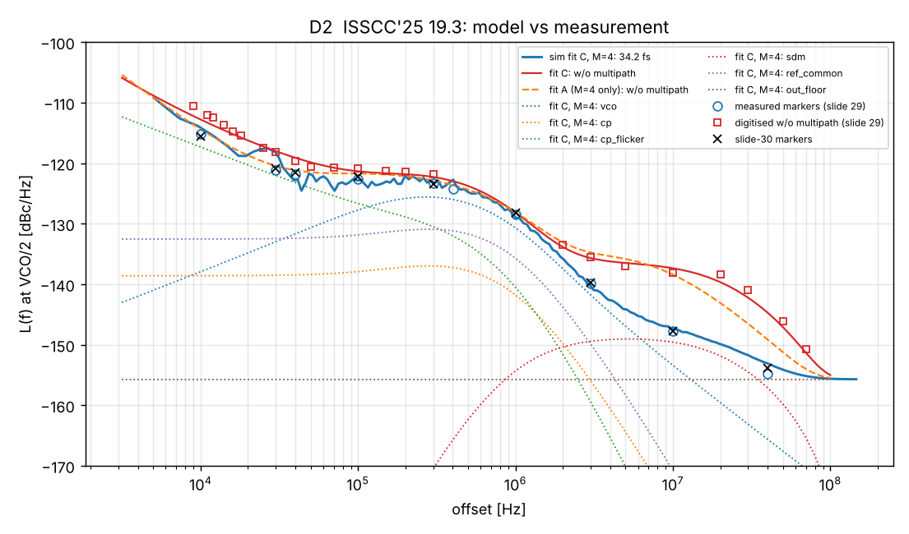
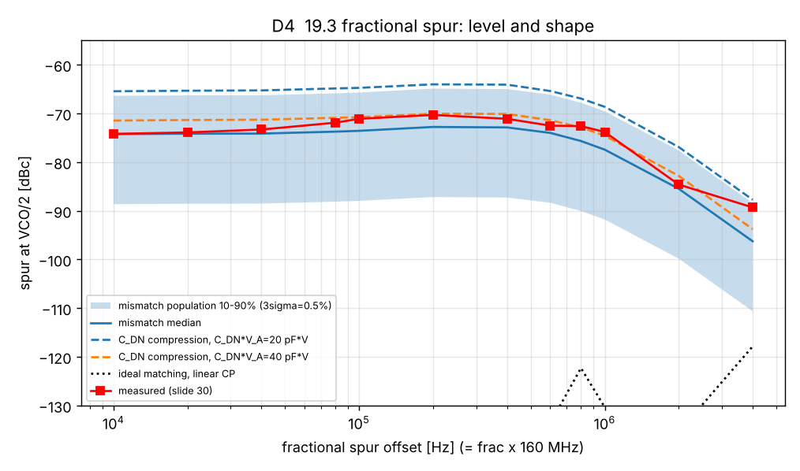
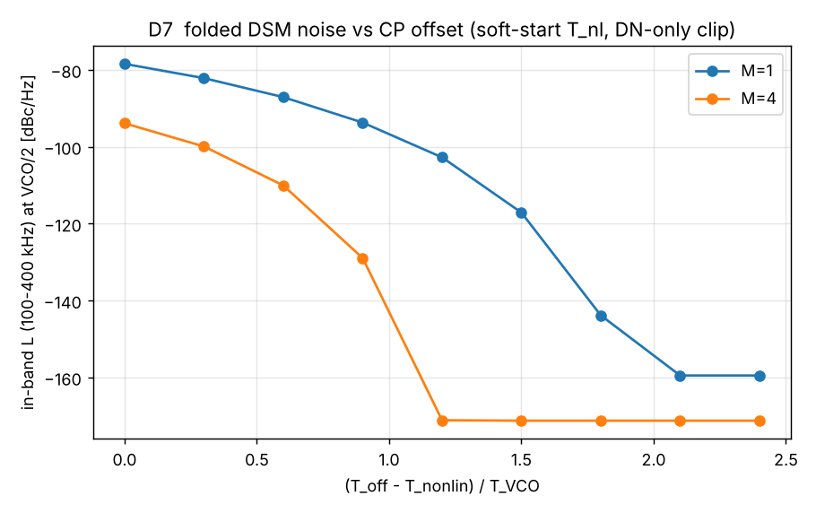

# MediaTek ISSCC 2025 19.3 多路径反馈小数分频 PLL：Python 复现、专利 US 11,509,315 核对、非理想因素与设计注意项

**对象：** ISSCC 2025 paper 19.3，*A Fractional-N PLL with 34fs_rms Jitter and −255.5dB FoM Based on a Multipath Feedback Technique*（C.-C. Hung, C.-H. Shen, C.-L. Lin, M. Tzou, K. Fong, Y.-L. Hsueh，MediaTek）。资料为 33 页报告幻灯片。
**核对对象：** US 11,509,315 B2《Fractional-N PLL and sliced charge pump control method thereof》（MediaTek，发明人 Po-Chun Huang、Yu-Li Hsueh；优先权 2020-10-19，授权 2022-11-22；16 项权利要求；文件名 `US11509315_MTK_QNC`）。
**模型与脚本：** `mtk_pll/mtkpll/multipath19p3.py`（模型），`mtk_pll/run_isscc25_19p3.py`（实验 D0~D9），专利算术复用 `mtk_pll/mtkpll/sliced_cp.py`。
**结果：** `mtk_pll/results/isscc25_19p3_results.json`、`run_isscc25_19p3.log`，图 `D2_*.png`、`D4_*.png`、`D7_*.png`。HTML 版技术分析报告（交互图表）：[ISSCC2025_19.3_技术分析报告.html](ISSCC2025_19.3_技术分析报告.html)。
**版本：** V3.1，2026-11-04。19.2（东京大学）部分已按要求删除；V1.0（专利 + ISSCC 2008）见 [MTK_PLL_QNC_Python复现与非理想分析.md](MTK_PLL_QNC_Python复现与非理想分析.md)。

---

## 0. 怎么读这份报告

每个检查都带一个类别，结论的分量取决于类别：

| 类别 | 含义 | 结果 |
|---|---|---|
| arith | 实现或算术恒等式（专利算术、FoM 换算等），按构造不会与资料矛盾 | 17 PASS（其中 4 项与 D0/D3 重复，独立 13 项） |
| consistency | 拟合后的模型与**同一批**数据比较，或跨信道复现性；只说明拟合成功，不是独立证据 | 6 PASS |
| validation | 与**未参与拟合**的数据、或与幻灯片上独立的仿真结论比较 | 4 PASS，5 DEVIATION |
| claim | 论文或专利的说法彼此对照，或拿模型去检验专利的说法 | 2 PASS，1 DEVIATION |

DEVIATION 表示资料中的某个说法或数据，模型复现不出来，或者资料本身不足以下结论；正文逐条说明。

本版经过两轮独立的对抗性评审：第一轮 24 个严重问题中确认 18 个，第二轮 13 个严重问题全部确认，另有 25 个次要问题。主要修正如下：
- 权利要求映射：权利要求 1 的核心是重定时电路；补上了方法权利要求 9~16。
- 撤回"专利四项收益在 19.3 中都得到印证"和"失配说法对杂散不成立"这两个过强的结论。
- 幻灯片 30 的检验不能区分模型，改为跨信道一致性检查。
- 参考噪底与 CP 噪声、CP 热噪声与 1/f 噪声都不可辨识，改为给出范围。
- 抖动-频率留出检验改用固定的 T_off。
- 修正了偏置电荷的锁定条件，以及 DN 截断时仍注入噪声的问题。

---

## 1. 结论速览

### 1.1 复现到了什么

- **相噪拟合：** 用幻灯片 29 的 10 个实测标记拟合环路和噪声参数，最大误差 0.49 dB，积分抖动 33.9 fs（实测 33.78 fs）。这是拟合结果，不是独立证据：只把这 10 个标记插值积分就能得到 33.3 fs。
- **专利算术：** 专利 FIG. 3/13 的算术（细分辨率 MASH → 积分器 → PSEL、进位）在 M = 2/4/8 下逐周期严格成立。19.3 的切片电流在 M=4 时与权利要求 6（n=2）完全一致，M=8 时与权利要求 7（n=3）完全一致。权利要求 5 只在 X=2 时与 19.3 重合。
- **"0.25X Q reduction"：** 按构造，M=4 相对 M=1 的 SDM 噪声为 −12.08 dB。用两条实测曲线反推，联合拟合代价在 15 dB 附近最小，12 dB 和 18 dB 也只略差；≤ 9 dB 明显不被支持。12 dB 与 15 dB 在数字化精度内分不开。
- **幻灯片 13 的折叠噪声：** 3σ = 0.5% 切片失配下的带内折叠噪声，模型得 −125.7 ~ −127.5 dBc/Hz，与幻灯片的 −127 dBc/Hz 相符。
- **幻灯片 13 / 专利 FIG. 15 的时序：** MUX/CK-Q 偏斜在满足建立时间时被重定时消除；重定时后的固定偏斜不产生杂散。
- **"同一 Q_OFST"假设被排除：** 如果关闭多路径时沿用 M=4 的偏置，模型给出的带内相噪是 −104 dBc/Hz，与实测的 −121 dBc/Hz 矛盾。所以关闭多路径的模式一定用了更大的锁定相差，与幻灯片 12 的说法一致。
- **参考杂散：** 在假设的 K_VCO = 150 MHz/V、Icp = 2 mA、T_nl = 50 ps 下，不经 S/H 时纹波杂散为 −77 ~ −83 dBc，远高于实测 −101 dBc，所以 S/H 电荷重分配是**必要的**。但模型加上 S/H 后预测 −117 ~ −129 dBc，比实测还低 16~28 dB，说明实测的 −101 dBc 由别的、未建模的机制决定。一个候选是倍频器奇偶沿交替约 5 ps，对应 80 MHz 杂散约 −102 dBc，但这未经证实。

### 1.2 复现不了、或资料不足以下结论的（DEVIATION）

1. **多路径的近端带内收益。** 实测 M=1→M=4 带内改善在 10k/20k/100k 为 3.8/2.9/1.7 dB。
   - 只用 M=4 拟合再预测 M=1（唯一能区分模型好坏的相噪留出检验）：误差 rms 2.66 dB，最大 5.6 dB，近端改善只给出 0.6~0.9 dB；关闭多路径的抖动预测 43.9 fs，而数字化曲线积分为 49.4 fs。
   - 加入随导通时间平方缩放的大 1/f 项（拟合 C）后，收益为 2.0/2.3/1.7 dB，10 kHz 处仍少约 1.8 dB。
   - 这个 1/f 项可以是 I_DN 的闪烁噪声，也可以是 Q_OFST 偏置/VDD 的 1/f 噪声（C_OFST 与 T_off 成正比）。它的等效拐点不可辨识，在 17 MHz 到拟合上界 300 MHz 之间都能拟合。
2. **抖动随 VCO 频率的趋势。** 冻结环路滤波器、T_off 固定为频段底端所需的 204 ps、VCO 相噪按幻灯片 27 的频率曲线：模型在 7.94 GHz 为 36.0 fs、9.5 GHz 为 35.4 fs；实测为 32.6 → 33.8 fs，斜率相反，最大差 3.4 fs。幻灯片没有给出各频段的环路参数和输出噪底。
3. **小数杂散的形状和成因。** 失配机理只解释了**幅度**：实测带内均值 −72.5 dBc 位于 3σ = 0.5% 总体的第 59 百分位（同一统计量的总体中位 −74.3 dBc）。但形状残差 1.79 dB。C_DN 电荷压缩（C_DN·V_A ≈ 40 pF·V，零失配）给出 −71.5 dBc、形状残差 1.85 dB，两种机理分不开。从 10 kHz 到 80 kHz 实测上升 2.3 dB（到 200 kHz 上升 3.9 dB），两种机理都没有复现。
4. **幻灯片 12 的"DSM 时间展宽 2T"。** M=4 时全部切片边沿的跨度是 2.45T，粗边沿本身是 1.72T。真正的偏置需求是 T_nl + 1.23T，而幻灯片公式假设 T_nl + T。所以该公式（2.25 dB）**高估**了热噪声收益（模型 1.58 dB），却**低估**了按导通时间平方缩放的 1/f 收益（3.15 dB）。
5. **专利"CP 噪声 −1~2 dB"。** 只看热噪声的导通时间比是 1.58 dB，在专利范围内（这是算术）；拟合模型里 CP 噪声总量（热噪声 + 1/f + 偏置）的收益是 2.85 dB（23.1 → 16.7 fs），超出 1~2 dB，与实测近端收益更接近。

### 1.3 最重要的设计注意项

1. **小数杂散需要同时控制切片电流比和 CP 电荷线性度。** 二者在幻灯片数据上分不开。
   - 失配：起作用的组合约为 ε_a + ε_b − 2ε_half（Icp/2 片权重加倍）。3σ = 0.5% 时，在 200 kHz 杂散信道上仿真 10 个样本，抖动中位 35.4 fs，第 90 百分位 41.5 fs。M=8 时为 38.3/47.7 fs，M 越大越敏感。
   - 电荷压缩：C_DN·V_A 须远大于 40 pF·V。
2. **CP 偏置要按频段最低端加容差设计。** 最小 T_off 在 9.5 GHz 为 178 ps，在 7.3 GHz 为 218 ps。偏置一旦小于 T_nl + 1.2T，折叠噪声会骤增 40 dB 以上。
3. **重定时余量 ≥ 5σ，而且每条 PSEL 路径都要单独核对。**
   - 4σ 时抖动 34 → 61 fs（每片独立 DFF）或 78 fs（共享第一级 DFF）。
   - 裕量小于路径偏斜时，会出现约 −9 dBc 的码相关杂散。
   - 5σ 的结论是从 4~4.5σ 外推的，见 §4.5。
4. **PSEL 与 N_MMD 必须同周期对齐。** PSEL 晚一个周期，抖动恶化到 153 fs，1 MHz 处相噪 −114.5 dBc/Hz。
5. **Q_OFST = C_OFST·VDD 让锁定相差直接受电源影响，约 0.22 ps/mV。** VDD/偏置噪声每个采样须 < 134 µV rms，其中的 1/f 成分会不加衰减地进入带内。这也是近端那个大 1/f 项的候选来源。
6. **倍频器占空比必须校准。** 45/55% 的 XO 不校准时，奇偶沿交替约 625 ps：80 MHz 杂散约 −60 dBc，T_off 还要多留约 313 ps。要做到 −101 dBc 级别，交替须小于约 5 ps。

---

## 2. 专利 US 11,509,315 B2 ↔ ISSCC 2025 19.3 逐项核对

### 2.1 权利要求与附图

| 专利条目 | 专利内容 | 19.3 幻灯片 | 模型证据 | 结论 |
|---|---|---|---|---|
| **权利要求 1**（独立） | 第一、第二电流源 + 第一、第二 PFD + 分频时钟控制器。控制器**包含重定时电路**：接收振荡时钟和两路分频时钟，按振荡时钟边沿对两路都做重定时。权利要求中**没有**环路滤波器 | 幻灯片 8：每片输出一个 DFF，时钟为 CK_VCO-GATED；连固定片也重定时 | D5（重定时器行为） | **一致**；19.3 增加了时钟门控（专利未写） |
| 权利要求 2 | MMD + SDM；第二分频时钟相对第一分频时钟延时整数个 T_VCO；延时与模数都由 SDM 控制 | 幻灯片 8：MMD、Digital Macro（MASH 1-1-1 → ∫ → PSEL、carry → N_MMD） | D0 逐周期恒等式（M = 2/4/8） | **一致** |
| SDM 35 + 累加器 37 + 加法器 38（说明书） | {D_N, D_f}，累加 D_f 得到 SEL 和进位 S，D_DIVISOR = D_N + S。说明书写的是"每个 VCO 周期累加"，但例子是按分频周期推进的 | 幻灯片 8 数字宏 | 模型按参考（分频）周期累加，按此解读说明书的写法；幻灯片的画法若按字面理解，粗 MASH 加截断积分会留下约 −88.9 dBc/Hz（VCO 处）的白噪声，与实测不符 | **一致**（以专利为准解读幻灯片） |
| 权利要求 3、4，FIG. 4 | DTC：延时单元（FIG. 4 用 DFF，说明书也允许带校准的 VCDL）+ MUX，延时 B·T_VCO | 幻灯片 8~11：两个共享 DFF 产生 CK_RETIME(0)/(1)，每片一个 MUX + 一个重定时 DFF | D9：二片式（FIG. 4/7/9）需 X−1 个 VCO 速率延时 DFF、额外脉宽 (X−1)T；19.3 的 binary 方式只需 1 个共享延时 DFF，但每片要一个 MUX 和一个重定时 DFF，额外脉宽 1T | **一致**；共享延时 DFF 是 19.3 的实现选择 |
| 权利要求 5，FIG. 5~10 | X 级：(1−1/X)·Icp 与 (1/X)·Icp；FIG. 7/9 为 X=4/8 的二片式 | 幻灯片 10：M=2 时 Icp/2 + Icp/2 | D9 检查 [0.5, 0.5] | 只在 **X=2 时重合**；19.3 在 M≥4 时不用二片式 |
| 权利要求 6，FIG. 11/12 | (1/2ⁿ, 1/2ⁿ, 2/2ⁿ)·Icp，n=2，延时 B1、B2 | 幻灯片 11：M=4 时 Icp/4、Icp/4、Icp/2，ΔQ = 0.25 与 0.5·Icp·T | D9 检查 [0.25, 0.25, 0.5] | **完全一致**（这就是 19.3 的实现点） |
| 权利要求 7，FIG. 13/14 | 再加 (4/2ⁿ)·Icp，n=3 | 对应 19.3 的 M=8 | D9 检查 [1/8, 1/8, 1/4, 1/2] | **一致** |
| 说明书第 14 栏（一般 M） | M 个支路：(1/2ⁿ), (1/2ⁿ), (1/2^(n−1)), …，n = M−1。注意专利的 M 是**支路数**，等于 19.3 的 P+1；19.3 的 M 是**级数**，等于 2^P。另外印刷公式最后一项 (1/2^(n−M)) 有笔误，应为 1/2 | 幻灯片 8 一般式 Icp/2、…、Icp/M、Icp/M | — | **一致**（符号含义不同，注意区分） |
| 权利要求 8 | 重定时电路触发器的**位置**：MMD→PFD1、DTC→PFD2 之间各一个 VCO 时钟 DFF | 幻灯片 8 的多路径重定时器 | — | **一致** |
| 权利要求 9~16（方法） | 9（独立）对应 1，含重定时步骤；10↔2，11↔3，12↔4，13↔5，14↔6，15↔7，16↔8 | 同上 | 同上 | **一致**（与装置权利要求一一对应） |
| FIG. 15 | ΔT1（MUX 路径）由重定时消除；ΔT2、ΔT3 固定，不随 SDM 变化，无噪声折叠 | 幻灯片 13 (1)(2)，幻灯片 14（ΔQ_fix 固定） | D5：10 ps 偏斜不重定时为 −29.9 dBc；重定时后（裕量 20 ps）回到理想底；固定偏斜同样回到理想底 | **一致**；补充：重定时裕量须大于偏斜，否则约 −9 dBc |
| FIG. 2 与说明书第 4 栏 | 偏置 T_OFFSET 保证 PFD/CP 线性；边沿抖动 ±1T（一阶 SDM）/ ±2T（二阶 SDM）；单位台阶 Icp·T | 幻灯片 12：MASH 1-1-1 展宽 4T；幻灯片 16~20：Q_OFST 由开关电容产生 + S/H | D0：M=1 时 3.91T；D6/D7 | **原理一致**；但专利的基准是二阶 SDM，19.3 是三阶 MASH，所以专利"CP −1~2 dB"与模型 1.58 dB 的数值吻合有一部分是巧合。开关电容 Q_OFST 与 S/H 是 19.3 新增的 |
| 说明书第 10 栏限制段 | 级数不能无限增加：二片式中 CP2 的额外脉宽 (X−1)T 必须在下一个参考沿之前结束 → 改用多支路（binary） | 19.3 用 binary | D9：在 160 MHz / 9.5 GHz 下，二片式脉冲结束时刻在 X = 2/4/8/16 时为 0.28/0.49/0.92/1.76 ns，都小于 T_ref/2 = 3.125 ns | **原理一致，但在 19.3 工作点这个限制并不起作用**（X ≤ 16）。binary 的实际收益是额外脉宽更短（1T 而非 (X−1)T，降低 CP 噪声和偏置需求）以及更少的 VCO 速率延时 DFF |
| — | — | 倍频器 DBL、双核反 Class-F VCO、VCO 时钟门控 | — | **19.3 新增**，专利未涉及 |

### 2.2 专利声明的效果 vs 19.3

| 专利声明 | 19.3 资料 | 模型（19.3 工作点） | 结论 |
|---|---|---|---|
| SDM 噪声 −6/−12/−18 dB（2/4/8 级） | 幻灯片 29："0.25X Q reduction (M=4)" | 按构造为 −6.02/−12.08/−18.07 dB；联合拟合代价在 6/9/12/15/18 dB 处为 18.4/8.8/4.2/3.2/4.4（最小值约 15 dB） | **与实测相容**；12 dB 与 15 dB 分不开；这不是独立测量 |
| T_OFFSET 变小，CP 噪声 −1~2 dB | 幻灯片 12 公式（2.25 dB）；幻灯片 29 "Better in-band PN due to less locked phase error" | 热噪声导通时间比 1.58 dB（算术；T_nl → 0 时为 2.05 dB）；拟合模型 CP 噪声总量 2.85 dB；实测带内 3.8/2.9/1.7 dB（10k/20k/100k） | **热噪声在 1~2 dB 内**（依赖 T_nl 假设）；但模型总量与实测近端收益都超出 1~2 dB，来源未闭合（DEVIATION 1/5） |
| PFD 噪声 −3 dB（切片越多降得越多） | 幻灯片未单独量化 | 10·log Σw²：等分 0.5/0.5 为 −3.01 dB；FIG. 7（0.75/0.25）−2.04 dB；FIG. 9（0.875/0.125）−1.07 dB；19.3 的 M=4 binary −4.26 dB；M=8 −4.64 dB | 算术成立，但只对**各片独立**的 PFD 噪声成立；参考/倍频噪声是公共项，不降低。幻灯片**无法检验**。专利第 8 栏说参考频率越高 PFD 噪声占比越大，这与 19.3 用倍频到 160 MHz 的做法对应 |
| 不需要 PRPS 和 DTC 校准 | 幻灯片 4：DTC 方案需要增益/INL 校准；19.3 全文没有校准 | 延时 = 整数 T_VCO，自动跟随 PVT | **一致**，但仅限"DTC 增益/INL 校准与 PRPS"：专利第 7 栏也给了带校准的 VCDL 方案；倍频器占空比仍需校正（D6） |
| 电流失配约 0.001，"远小于时序失配……不是主要问题" | 幻灯片 13：3σ = 0.5% 时折叠噪声 −127 dBc/Hz，"low enough" | **比较性说法成立**：0.001 电流失配的杂散约 −78.7 dBc（按 σ 理解）或 −88.2 dBc（按 3σ 理解），而 1 ps 未重定时的时序偏斜是 −49.9 dBc。绝对量：实测带内 −72.5 dBc（VCO/2）对应的 3σ 置信区间为 0.22%~5.7%；零失配下的 C_DN 压缩同样能解释 | **比较性说法成立；实测杂散是不是失配造成的，无法确定**。对 −70 dBc 量级的杂散规格，0.1~0.5% 级的失配已不可忽略 |
| RMS 抖动 < 50 fs（专利举例） | 实测 33.78 fs（10k~100M，VCO/2） | 拟合模型 33.9~34.3 fs | **由实测满足**（这是论文与专利的对照，没有用到模型） |
| 可放宽 VCO 噪声预算以省功耗 | 19.3 仍用 15.4 mW 的双核 VCO | VCO 是最大单项，约 23.6 fs | 19.3 把余量用于压低总抖动，而不是降低 VCO 功耗 |

### 2.3 核对小结

19.3 是专利 binary 实施例（FIG. 11/13，权利要求 6/7）的流片：
- 独立权利要求 1/9 的核心（两路切片 + 重定时）、权利要求 2~4、6~8 以及对应的方法权利要求，逐项都有体现。
- 权利要求 5 的二片式只在 M=2 时与之重合。
- 在专利基础上新增了开关电容 Q_OFST + S/H 的 CP、倍频器、双核 VCO 和 VCO 时钟门控。

专利的量化收益中：
- **SDM −12 dB**：与实测曲线相容（最优约 15 dB，12~18 dB 都可接受），但不是独立测量。
- **CP**：热噪声 −1.58 dB 按算术落在 1~2 dB 内，但拟合模型的总量（2.85 dB）和实测近端收益（10 kHz 处 3.8 dB）都更大，来源未闭合。
- **PFD**：−4.26 dB 只是 Σw² 算术，幻灯片无法检验。
- **< 50 fs**：由实测 33.8 fs 满足。

专利关于电流失配的**比较性说法成立**（远小于未重定时的时序失配）。但 V1.0 报告 A3 节的"失配 → 锯齿 B → 带内杂散"机理，只在**幅度**上与实测相容（第 59 百分位），从幻灯片数据无法把它与 C_DN 电荷压缩区分开，机理没有被验证。

---

## 3. 架构与模型

### 3.1 19.3 架构要点

- 参考：80 MHz XO 经倍频器得到 160 MHz PFD；VCO 7.3~9.5 GHz，在 VCO/2 处测量。
- 多路径：M=4（P=2），三个切片 Icp/2、Icp/4（受 PSEL 控制）和 Icp/4（固定）。幻灯片上 PSEL[k] 的权重为 2^-(k+1)（MSB 在前），模型里 B 的第 (P−1−k) 位与它对应。
- CP：只开关一个 I_DN 电流源；反向电荷 Q_OFST = C_OFST·VDD 来自电容并经 M2 转移；电荷先存在 C_UP/C_DN 上，每周期在采样相一次性重分配到 C1。

### 3.2 模型（`multipath19p3.py`）

**核心：**
- 每个 PFD 周期一步，四状态环路滤波器 + VCO 用精确状态空间离散，2 倍子步。
- 每个切片的电荷按它自己的边沿时刻计算。
- CP 只有 DN 方向：符号相反的脉宽截断为 0，且此时不注入噪声。
- 可选的电荷非线性：软启动（T_nl 内电流线性爬升）、C_DN 电荷压缩。
- 偏置电荷用同一条电荷律在 T_off 处取平均来确定，锁定点误差为 0.00 ps。

**噪声源：**
- VCO：用幻灯片 27 的标记拟合 a₃/f³ + a₂/f² + a₀（rms 误差 0.40 dB，1/f³ 拐点 305 kHz），再按此谱合成时间序列；a₀ 当作 ÷2 之后的输出噪底。
- 参考：白噪底（假设 −168 dBc/Hz@80 MHz，约 100 fs/沿）+ XO 近端 1/f²（拟合）。
- PFD：每片独立 60 fs（假设）。
- CP：I_DN 热噪声 4kTγ·gm × 脉宽，再加一个按（导通时间）² 缩放的 1/f 项（拟合）。
- 偏置电荷：2kT·C_OFST，只是下限。

**解析模型：** 同参数的线性分量模型，用于拟合；与时域仿真对比，3 个种子 34.18 ± 0.15 fs，解析 34.31 fs。

### 3.3 拟合与可辨识性

| 拟合 | 数据 | 主要结果 | 残差 |
|---|---|---|---|
| A | 只用 M=4 的 10 个标记 | fc 0.58 MHz，PM 67°，BW 0.89 MHz，p3 = 10×fc，CP 倍率 2.1（1/f 拐点固定 2 MHz） | 最大 0.49 dB；抖动 33.9 fs |
| C（主模型） | M=4 标记 + 数字化的 M=1 曲线（权重 0.5） | fc 0.61 MHz，PM 60°，BW 0.98 MHz，p3 = 30×fc，CP 倍率 0.42，I_DN 1/f 拐点 47 MHz（本组；剖面中为 17 MHz~≥ 300 MHz，后者顶到拟合上界） | M=4 最大 1.75 dB；M=1 rms 0.79 dB；抖动 34.3 fs |

可辨识性剖面：
- 剖面 1：参考噪底 −170/−168/−166 dBc/Hz × T_nl 10/30/50 ps，代价 3.64~4.34。
- 剖面 2：把 CP 热噪声倍率固定在 0.1~1，代价 4.16~4.26，对应的 1/f 拐点 206 → 18 MHz。

在代价比最优值高不到 1.5 的 12 组拟合里，各分量抖动范围：

| 分量 | 范围 [fs] |
|---|---|
| VCO | 23.5~23.7 |
| 参考白噪 | 10.1~16.1 |
| CP 1/f | 13.4~15.3 |
| CP 热噪声 | 2.4~10.9 |
| SDM | 8.1~8.2 |
| 输出噪底 | 7.7 |
| 参考 1/f | 5.4~6.2 |
| PFD | 4.6~4.7 |
| 偏置 kT/C | 3.4~3.9 |

结论：
- 对参考噪底和 T_nl 这两个剖面不敏感的有：VCO、SDM、输出噪底（输出噪底由 VCO 拟合直接确定）。
- 参考 vs CP、CP 热噪声 vs CP 1/f 都不可辨识。
- 没有做剖面的假设：Icp、K_VCO、每片 PFD 抖动、VDD。

---

## 4. 复现验证结果

### 4.1 D0：算术与时间展宽

| M | 粗边沿峰峰值 | 有效边沿峰峰值 | 全部切片跨度 | 所需 T_off |
|---|---|---|---|---|
| 1 | 3.91T | 3.91T | 3.91T | T_nl + 1.97T |
| 2 | 2.43T | 1.95T | 2.91T | T_nl + 1.47T |
| 4 | 1.72T | 0.99T | 2.45T | T_nl + 1.23T |
| 8 | 1.35T | 0.48T | 2.22T | T_nl + 1.12T |

### 4.2 D1：品质因数核算（arith）

全部吻合：
- VCO：L(1 MHz)@9.5 GHz = −126.43 dBc/Hz（标称 −126.59）；FoM 194.27（194.3）；FoM_T 200.29（200.23）。
- PLL：FoM −255.55/−254.60（−255.5/−254.6）；FoM_N −276.3，注意 f_ref 取 80 MHz 的 XO 频率。
- 含杂散抖动：33.78 fs 加上幻灯片 30 的 −70.88 dBc 一对杂散得 36.43 fs，报告值 37.69 fs，差值来自其他杂散线。

### 4.3 D2/D3：相噪与留出检验



| 检查 | 类别 | 结果 |
|---|---|---|
| 拟合 A 对 10 个标记 | consistency | 最大 0.49 dB，PASS |
| 时域仿真 vs 解析 | consistency | 34.18 ± 0.15 fs vs 34.31 fs，PASS |
| 抖动 vs 33.78 fs | consistency | 34.18 fs，PASS（由拟合决定；只用标记积分就有 33.3 fs） |
| H2：幻灯片 30 的 9 个标记 | consistency | rms 0.44/0.54 dB，PASS；但直接照抄幻灯片 29 的标记也有 0.42 dB，所以这项区分不了模型 |
| H1：只用 M=4 拟合，预测 M=1 曲线 | validation | rms 2.66 dB、最大 5.6 dB，DEVIATION（唯一能区分模型的相噪留出检验） |
| H3：抖动随 VCO 频率变化 | validation | 斜率相反，最大差 3.4 fs，DEVIATION |
| H4："同一 Q_OFST"假设 | validation | 模型 −104.4 dBc/Hz vs 实测 −120.9，假设被排除，PASS |
| D3：SDM 降幅剖面 | consistency | 代价在 6/9/12/15/18 dB 处为 18.4/8.8/4.2/3.2/4.4；≤ 9 dB 不被支持，PASS |

### 4.4 D4：小数杂散



- **方法：** 杂散相量 X(f) = X₀(f) + Σ aₖ(f)·εₖ，对切片电流误差严格线性。系数相对大小：Icp/4 固定片 : Icp/4 PSEL 片 : Icp/2 PSEL 片 = 0.50 : 0.50 : 1.00。
- **幅度：** 实测带内均值 −72.5 dBc，位于 3σ = 0.5% 总体的第 59 百分位（总体中位 −74.3 dBc），PASS。3σ 的 90% 置信区间为 0.22%~5.7%：单颗芯片的数据只能给出这么宽的范围。若把专利的 0.001 当作 σ，预测中位 −78.7 dBc（实测在第 83 百分位）；当作 3σ，预测 −88.2 dBc（实测高于所有样本）。
- **形状：** 失配机理残差 1.79 dB，C_DN 压缩 1.84~1.89 dB，二者分不开（两项 DEVIATION）。C_DN·V_A ≈ 40 pF·V 单独就给出 −71.5 dBc。
- **折叠噪声：** 最坏方向的 3σ 给 −125.7 dBc/Hz，Icp/2 片单独失配 0.5% 给 −127.5 dBc/Hz；幻灯片 13 为 −127，PASS。

### 4.5 D5：时序

| 场景 | 结果（VCO/2 处） |
|---|---|
| MUX/CK-Q 偏斜 1/3/10 ps，不重定时 | −49.9/−40.4/−29.9 dBc |
| 重定时，裕量 20 ps | 回到理想底 |
| 裕量 5 ps < 偏斜 10 ps | −9.4 dBc |
| 重定时后的固定偏斜 | 理想底 |

重定时器滑周期（σ = 1.5 ps）：

| 裕量 | 每片独立 DFF | 共享第一级 DFF |
|---|---|---|
| 3.5σ | 128 fs | 198 fs |
| 4σ | 61 fs | 78 fs |
| 4.5σ | 38 fs | 38 fs |

5σ 和 6σ 时，在 2²⁰ 个周期的仿真中没有观察到滑周期。但 5σ 时预期每片约 0.3 次，在 160 MHz 下相当于约 46 次/秒，所以"≥ 5σ"是从 4~4.5σ 外推出来的，不是直接仿真证明的。

PSEL 晚一个周期：抖动 153 fs，L(1 MHz) = −114.5 dBc/Hz。

### 4.6 D6：偏置电荷、参考杂散、倍频器

以下数值基于假设 Icp = 2 mA、K_VCO = 150 MHz/V、T_nl = 50 ps。

- **偏置噪声：** Q_OFST = 357 fC，C_OFST = 446 fF。开关电容 kT/C 为 30.4 fs/沿（下限）；泄放电流（同一 gm 模型，只计热噪声）为 49.8 fs/沿。
- **电源灵敏度：** 0.223 ps/mV。

参考杂散（160 MHz，在 VCO 处），p3 = 8 / 30 / 40：

| 电荷注入方式 | 8 | 30 | 40 |
|---|---|---|---|
| 泄放电流偏置 | −92 | −83 | −81 dBc |
| 开关电容偏置，CP 脉冲不经 S/H | −86 | −77 | −75 dBc |
| S/H 重分配，偏斜 20 ps | −126 | −117 | −114 dBc |
| S/H 重分配，偏斜 5 ps | −138 | −129 | −127 dBc |

倍频器奇偶沿交替 1/5/20/625 ps 时：80 MHz 杂散 −116/−102/−90/−60 dBc，T_off 需额外 0.5/2.5/10/312.5 ps。

### 4.7 D7：偏置与 CP 非线性



带内折叠噪声（100~400 kHz，VCO/2），横轴为 (T_off − T_nl)/T：

| (T_off − T_nl)/T | 0.9 | 1.2 | 1.5 | 1.8 | 2.1 |
|---|---|---|---|---|---|
| M=1 | −94 | −103 | −117 | −144 | −159 dBc/Hz |
| M=4 | −129 | −171 | −171 | −171 | −171 dBc/Hz |

最小 T_off：9.5 GHz 为 178 ps，7.3 GHz 为 218 ps。

### 4.8 D8：抖动预算

只计噪声（解析）：

| 情形 | 抖动 |
|---|---|
| M=4 | 34.3 fs |
| 关闭多路径 | 49.3 fs |
| M=2 | 37.9 fs |
| M=8 | 33.1 fs |
| M=16 | 32.6 fs |
| 去掉倍频器 | 54.0 fs |

计入杂散和折叠噪声：在 200 kHz 杂散信道上仿真 10 个失配样本（3σ = 0.5%，原始频点积分）：

| M | 无失配 | 中位 | 第 90 百分位 |
|---|---|---|---|
| 2 | 38.3 fs | 38.4 fs | 38.8 fs（M=2 的 B 被 SDM 打乱，失配几乎不起作用） |
| 4 | 34.2 fs | 35.4 fs | 41.5 fs |
| 8 | 32.9 fs | 38.3 fs | 47.7 fs |

M=8 的噪声收益（约 1 fs）会被更高的失配敏感度抵消，**M=4 是合理的折中点**。

---

## 5. 设计注意项清单（按优先级）

| # | 注意项 | 依据（模型数值） | 建议 |
|---|---|---|---|
| 1 | 切片电流比匹配与 CP 电荷线性度 | 起作用的组合约为 ε_a + ε_b − 2ε_half；3σ = 0.5% 时第 90 百分位抖动 41.5 fs；C_DN·V_A ≈ 40 pF·V 单独就产生实测量级的杂散；二者在数据上分不开 | 所有切片用同一单元拼成，共质心布局，长沟道，cascode；后仿提取每片 Q 随脉宽的曲线；要求 C_DN·V_A ≫ 40 pF·V；必要时加后台校准（以 PSEL 为回归量）或单元轮换 |
| 2 | 偏置 T_off = Q_OFST/I_DN | 最小值 9.5 GHz 时 178 ps、7.3 GHz 时 218 ps；低于 T_nl + 1.2T 时折叠骤增 > 40 dB | 按频段底端，加上 VDD、C、I 容差和倍频器残差来设计；每个角落做良率扫描 |
| 3 | 重定时与门控 VCO 时钟（T_VCO = 105 ps） | 4σ 裕量时抖动 61/78 fs；裕量小于偏斜时约 −9 dBc | 按 PVT 对每条 PSEL 路径做 STA，裕量 ≥ 5σ；第一级共享 DFF 一旦出错影响全部切片，要求更严 |
| 4 | PSEL 与 N_MMD 的流水线对齐 | 晚一个周期 → 153 fs | 匹配时延，并检查 PSEL 相对 CK_RETIME 的建立/保持 |
| 5 | Q_OFST 的电源/偏置噪声 | 0.223 ps/mV；1/f 直接进带内；可能就是近端那个大 1/f 项 | 为 Q_OFST 单独配 LDO 和滤波；M1/R 偏置用低 1/f 器件；仿真时作为独立噪声源 |
| 6 | 倍频器占空比 | 不校准时约 625 ps，杂散 −60 dBc，T_off 多约 313 ps；要求交替 < 约 5 ps | 占空比校准是必需的，并且把校准残差计入 T_off 预算 |
| 7 | 参考杂散 | 不经 S/H 为 −77 ~ −83 dBc；经 S/H 后模型 −117 dBc，低于实测 −101 dBc | S/H 同时重分配是必要条件；实测的 −101 dBc 由其他机制决定（例如倍频器残差、耦合），需要单独查 |
| 8 | M 的选择 | M=4→8 噪声只降约 1 fs，失配敏感度上升 | 保持 M=4；先解决匹配问题再考虑增大 M |
| 9 | 抖动预算 | VCO 约 23.6 fs 最大；近端由 CP/偏置的 1/f 项主导 | 下一步应从 VCO 和近端 1/f 入手 |

---

## 6. 模型边界与未闭合项

- **只有幻灯片，没有正文。**
  - 假设值：Icp、K_VCO、T_nl、VDD、每片 PFD 抖动、参考白噪底。
  - 拟合值：fc、PM、p3、CP 噪声倍率和 1/f 拐点、XO 近端噪声。
  - 绝对的偏置噪声、参考杂散依赖这些假设；dB 改善量和机理结论对它们不敏感。
- **数字化误差：**
  - 浅色曲线：9~300 kHz 为像素提取，±1 dB；2~10 MHz 为目读，±1.5 dB，其中 4~12 MHz 被文字遮挡。
  - 小数杂散点：y 方向 ±0.15 dB，x 方向取整到"整齐的偏移频率"。
- **未闭合：** 近端多路径收益的来源、抖动随 VCO 频率的趋势、小数杂散的成因、实测 −101 dBc 参考杂散的来源。
- **未建模：** 参考周期内的脉冲纹波（图中 160 MHz 处谱线是冲激近似的产物）、VCO 双核模式竞争、器件级电荷注入与过压、泄放源的 1/f 噪声。

---

## 7. 复跑

```bash
cd mtk_pll && pip install -r requirements.txt
```

```bash
python3 run_isscc25_19p3.py      # 约 40 s，35 项检查，按类别汇总
```
