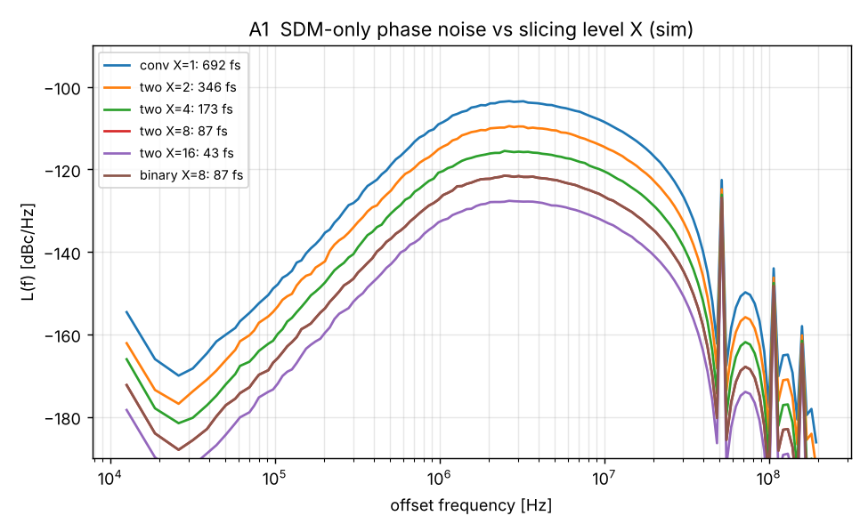
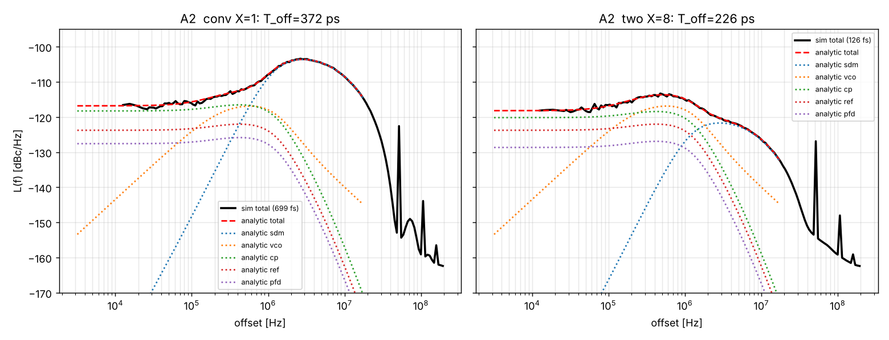
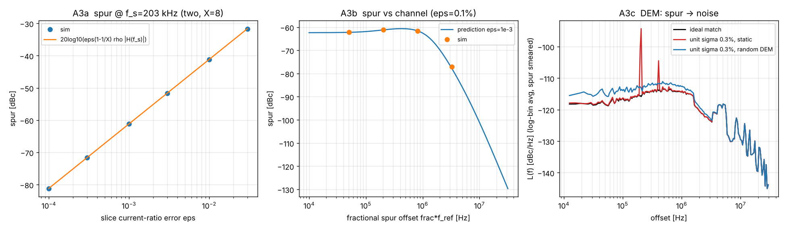
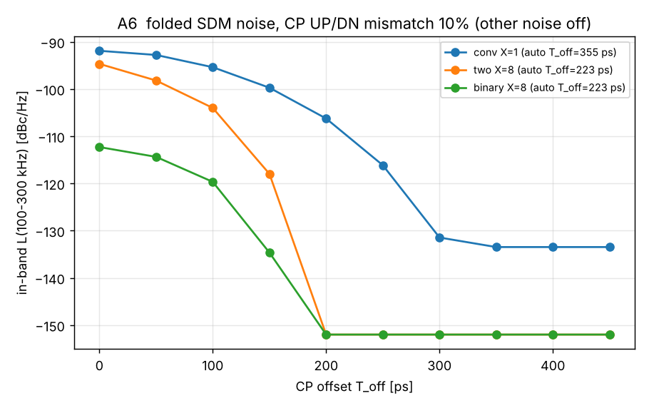
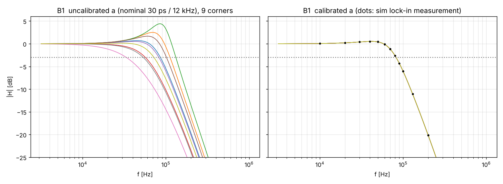
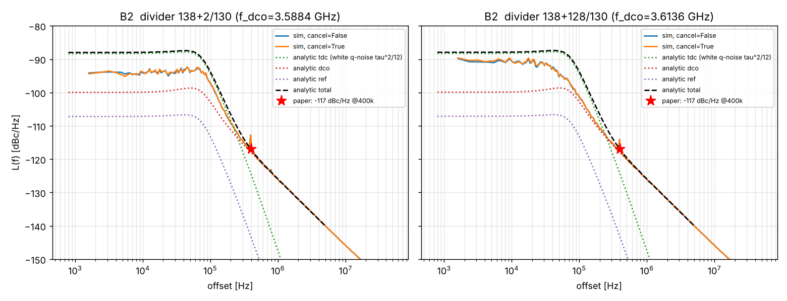

# MTK 小数分频 PLL 量化噪声抵消（QNC）方案：Python 复现验证、非理想因素分析与设计注意项

**文档性质：** 行为级建模复现报告 + 设计评估清单。
**模型与脚本：** [`mtk_pll/`](../mtk_pll/)。结果数据：`mtk_pll/results/*.json`；图：`mtk_pll/results/*.png`。
**版本：** V1.0，2026-11-04。

---

## 0. 范围与资料说明（先读）

本报告的复现对象是随任务提供的两份 MediaTek 资料：

| 编号 | 资料 | 核心技术 | 本报告中的代号 |
|---|---|---|---|
| S1 | US 11,509,315 B2《Fractional-N PLL and sliced charge pump control method thereof》（MediaTek，优先权日 2020-10-19，授权 2022-11-22） | 切片电荷泵（sliced CP），用整数 T_VCO 延时（DFF 链 "DTC"）实现 1/X 细量化台阶，从而抵消 SDM 量化噪声；VCO 时钟重定时 | **A：切片 CP PLL** |
| S2 | ISSCC 2008, paper 10.1, H.-H. Chang 等（MediaTek）《A Fractional Spur-Free ADPLL with Loop-Gain Calibration and Phase-Noise Cancellation for GSM/GPRS/EDGE》 | 环形 TDC（CTDC）+ BB 积分路径的 ADPLL，数字环路增益校准，数字相噪（ΔΣ 量化误差）抵消 | **B：2008 ADPLL** |

> **关于 "ISSCC 2025"：** 上传的论文 PDF 元数据与页眉都是 **ISSCC 2008 / Session 10.1**，不是 2025。我检索了 "ISSCC 2025 MediaTek 切片电荷泵 PLL"，没有找到与上述专利对应的 ISSCC 2025 论文。一篇 2025 年的 ISSCC 低抖动 PLL 综述（Journal of Semiconductors 46(7)）所在站点在当前网络策略下无法访问，未能核实。因此本报告复现的是上述两份资料本身。如果手头有 ISSCC 2025 的 MTK 论文 PDF，把其中的 f_ref、f_VCO、BW、Icp、X 等参数填进 `SlicedCPParams` / `ADPLLParams` 即可复跑，模型结构不需要改。

两份资料都属于 "量化噪声抵消（QNC）"，但抵消增益的来源不同：

- **A**：抵消增益 = CP 切片电流比。延时单位天然等于 T_VCO，所以不需要 DTC 增益校准；风险转移到**电流比匹配**。
- **B**：抵消增益 = 2ΔN/(M+F)，由 TDC 半周期归一化得到；风险在**TDC 增益/偏移/非线性**以及**参考占空比**。

---

## 1. 结论速览

### 1.1 声明 vs 模型结果

| 来源声明 | 模型结果 | 状态 |
|---|---|---|
| A：有效模数 = D_N + S + ΔB/X，即 SDM 量化台阶缩小为 1/X（专利 FIG. 3~10 的算术） | 6 种切片配置（conv、two X=2/4/8、binary X=4/8）的整数恒等式全部严格成立 | PASS |
| A：SDM 噪声降低 6/12/18 dB（X=2/4/8） | −6.03 / −12.06 / −18.06 dB（X=16：−24.08 dB），仿真与解析相差 < 0.02 dB | PASS |
| A：T_OFFSET 变小，CP 噪声降低 1~2 dB | T_off 372→226 ps，带内 CP 噪声 −1.9 dB（two X=8）、−1.7 dB（binary X=8） | PASS |
| A：PFD 切成两路，PFD 噪声 −3 dB | −3.19 dB（理论 10·log Σw_i² = −3.01 dB）。two X=8 只有 −1.3 dB；binary X=8 为 −4.8 dB | PASS（条件见 §5.A2） |
| A：ΔT2/ΔT3 恒定，不参与 SDM，无噪声折叠 | 20 ps 后级偏斜：杂散不变（−125 dBc），抖动 125.8 fs 不变 | PASS |
| A：重定时消除 ΔT1 | 不重定时 ΔT1=5 ps → −49.9 dBc 杂散（理论 −49.7）；重定时后 −125 dBc | PASS |
| A：电流失配约 0.1%，"不是主要问题" | **只对噪声成立，对带内小数杂散不成立**：ε=0.1% → −61 dBc 带内小数杂散（近整数信道） | **风险项**（§4.A3） |
| A：RMS 抖动 < 50 fs | 代表性参数（52 MHz/6 GHz/BW 800 kHz）：conv 699 fs → X=8 126 fs。要到约 54 fs 需要 X=16 binary、f_ref=104 MHz、VCO −124 dBc/Hz@1 MHz、Icp 4 mA | 条件性（§4.A8） |
| B：环路增益校准式 a = TDCgain/DCOgain·2π·BW·M·Fref 给出 50 kHz | 9 个 PVT 角（τ 20/30/45 ps × K_DCO ±30%）校准后 50.00~50.05 kHz；不校准时 23~98 kHz | PASS |
| B：e_CTDC = Σe_ΔΣ·2ΔN/(M+F) 抵消 ΔΣ 误差 | 增益误差 4×10⁻⁵；理想 TDC + 线性环路时，ΔΣ 杂散从 −103 dBc 降到数值零 | PASS |
| B：400 kHz 处 PN = −117 dBc/Hz | −117.7 / −117.9 dBc/Hz（138+2/130、138+128/130） | PASS（DCO 噪声按此标定，见 §3.2） |
| B：小数杂散低于相噪、不可见 | 30 ps TDC 量化确定性 ΔΣ 图样，残余 400 kHz 杂散 −72/−74 dBc，在 1 kHz RBW 下可见 | **DEVIATION**（§4.B2 解释） |

脚本自检：A 30/30 PASS；B 10 PASS + 2 DEVIATION（均为上表最后一行）。

### 1.2 最重要的设计风险（按优先级）

1. **A：切片电流比失配直接变成带内小数杂散。** 杂散 ≈ 20·log₁₀(ε·(1−1/X)·ρ_X·|H(f_s)|)，X=8 时 ρ≈0.87。要做到 −70 dBc，需要 ε ≲ 0.035%；−80 dBc 需要 ε ≲ 0.011%。最坏信道是 frac·f_ref < 环路带宽的近整数信道。
2. **A：重定时时序余量。** 余量 4σ 时滑周期率 2.5×10⁻⁵，抖动从 126 fs 恶化到 237 fs。如果只有某个 B 码路径（如 B=0 旁路）余量不足，会出现 −36 dBc 的码相关杂散。
3. **B：符号-幅度型 PFD+CTDC 的零点 DNL。** 整数 Offset 校准去不掉 t_os/τ 的小数部分，ΔΣ 抖动每拍都穿越零点，杂散在 −72~−52 dBc 之间随 PVT 漂移。锁定点加相位偏置（> ΔΣ 摆幅）后杂散不再随 t_os/τ 变化。
4. **B：参考占空比误差会同时污染环路带宽和抵消增益**（因为半周期归一化）：BW ∝ 1/(2d)，抵消残差 ∝ |2d−1|。
5. **B：残余小数杂散由 TDC 量化决定，数字抵消去不掉。** 降杂散要靠 ΔΣ 加扰（−97 dBc，抖动 +156 fs）、更高阶 DLF（−81 dBc）或更细的 TDC。

---

## 2. 方案原理与复现要点

### 2.1 A：切片 CP 小数分频 PLL（US 11,509,315 B2）

信号链（专利 FIG. 3/4）：

```
N.f ─► SDM(35) ─► {D_N, D_f}
D_f ─► 累加器(37, mod X) ─► SEL(=B), 进位 S
D_DIVISOR = D_N + S ─► MMD(34) ─► CK_MMD
CK_MMD ─► DTC(361：VCO 时钟的 DFF 链 + MUX) ─► CK_MMD + B·T_VCO
重定时(362：DFF 由 CK_VCO 打拍) ─► CK_DIV,1 / CK_DIV,2 …
PFD_i + CP_i（电流 w_i·Icp）─► 共用 LPF(32) ─► VCO(33)
```

**关键恒等式**（模型对每个周期逐一做整数校验）：令细 SDM 的输出 y = X·N.f 的量化值（LSB = T_VCO/X），D_N = ⌊y/X⌋，D_f = y mod X，B[k] = (B[k−1] + D_f) mod X，S = 进位，则

- 有效模数：D_N + S + (B[k] − B[k−1])/X = y/X（逐周期严格相等）
- 各切片电荷的加权边沿：Σ w_i·(r₁ + d_i) = r_eff = 细 SDM 的累积误差

其中 r₁ 是粗边沿（MMD 输出）的累积误差（单位 VCO 周期），d_i 是第 i 片的整数延时。所以环路看到的是量化台阶为 T_VCO/X 的 SDM，量化噪声降低 20·log₁₀X。

**切片方式：**

| 代号 | 专利图 | 切片权重 | 延时 d_i | 最大附加导通时间 |
|---|---|---|---|---|
| conv | FIG. 1 | 1 | 0 | 0 |
| two | FIG. 5/7/9 | (1−1/X), 1/X | 0, B（B∈0…X−1） | (X−1)·T_VCO |
| binary | FIG. 11/13 | 1/X, 1/X, 2/X, 4/X… | 0, b₀, b₁, b₂…（B 的各位） | 1·T_VCO |

**这种 "DTC" 的本质优势：** 延时由 VCO 时钟的 DFF 打拍产生，天然等于整数个 T_VCO，跟着 PVT 自动跟踪，不需要像模拟 DTC 那样做增益/INL 校准。代价是细台阶的精度转移到了**电流比** w₂ = 1/X 上（§4.A3）。

**一个推论（专利没有写，但模型验证了）：** binary 切片只需要 CK_MMD 和 CK_MMD+1·T_VCO 两个时钟。整个 DTC 只要 1 个 DFF 加每片一个 MUX，而 two 切片要 X−1 个高速 DFF。

### 2.2 B：ISSCC 2008 ADPLL

- **PFD + CTDC**：32 级环形延时线 + 5 bit 周期计数，LSB ≈ 30 ps（0.13 µm 反相器），量程 31 ns。PFD 的 Lag 给出符号，TDC 给出幅度（符号-幅度结构）。BB 符号并入相位字，消除死区。
- **TDC 校准**：Offset（A=B=REF）→ Offset = TDC_pre；归一化（A=REF、B=REFB，即半个参考周期）→ ΔN；TDCgain = 1/(2·ΔN·Fref)。
- **DLF**：前馈路径 = 可编程 IIR 低通 × a（比例）；积分路径只取相位误差的符号 → 20 bit UP/DN 计数 × b。
- **环路增益校准**：Loop gain = a·DCOgain/(TDCgain·M·Fref²) = 2π·BW/Fref，所以 a = TDCgain/DCOgain·2π·BW·M·Fref。DCOgain = ΔF·Fref/ΔI，通过预置分频比阶跃 ΔF 测量跟踪码变化 ΔI 得到。
- **数字相噪抵消**：e_CTDC[k] = Σ_{n<k} e_ΔΣ[n]·T_DCO/TDCgain = Σ e_ΔΣ[n]·2ΔN/(M+F)，从 TDC 字中减去。

---

## 3. 模型与方法

### 3.1 建模层级

| 项目 | A：切片 CP PLL | B：2008 ADPLL |
|---|---|---|
| 时间步 | 每参考周期 1 步 + os=8 子步（输出谱可到 4·f_ref） | 每参考周期 1 步 + os=4 子步 |
| 环路 | C2‖(R1+C1) + R3/C3 无源滤波器（四阶 II 型）与 VCO 相位的**精确状态空间离散**；CP 电荷按冲激注入，常值泄放电流（T_off）精确积分 | DCO 频率 ZOH 积分；DLF 为定点 IIR；BB 积分计数；可设附加时延 |
| 逐边沿非理想 | 每片按自己的边沿时刻计算电荷：电流比失配 ε、DEM、UP/DN 失配 β、前级偏斜 ΔT1（码相关）、后级偏斜 ΔT2/ΔT3、重定时余量与滑周期、MMD 抖动 | TDC 是真实的时间→计数量化器：级失配 INL、t_os 偏移、整数 Offset 校准、占空比、τ 漂移、周期计数误判、TDC 热抖动、相位偏置 |
| 噪声源 | VCO 1/f²、参考底噪、每片 PFD 抖动（独立）、CP 热噪声（按导通时间 + 泄放源） | DCO 1/f²、参考底噪、TDC 量化（内生）、可选 TDC 抖动 |
| 交叉验证 | 线性 s 域噪声模型（各分量）与仿真对比：相噪偏差 < 0.5 dB，抖动偏差 < 0.5% | z 域闭环 H(z) 与仿真锁相注入实测对比：< 0.03 dB；白量化噪声解析模型 |
| 不建模 | 参考周期内的脉冲纹波（参考杂散）、电源/衬底耦合、开关电荷注入、VCO 1/f³ | DCO 电容阵列结构（DNL 只给了分析）、电源耦合、TDC 的亚稳态细节 |

### 3.2 参数（**标 \* 的是假设**，资料中没有）

**A（代表性 6 GHz 蜂窝/连接合成器）：** f_ref = 52 MHz\*，N.f = 115.2718\*（f_VCO = 5.994 GHz，T_VCO = 166.8 ps），Icp = 2 mA\*，K_VCO = 100 MHz/V\*，交越频率 800 kHz、PM 54°\*（R1 = 3.14 kΩ，C1 = 280 pF，C2 = 15.2 pF，R3 = 21.9 kΩ，C3 = 1.52 pF），MASH 1-1-1（2²⁴ 模，一阶整形 LSB 加扰），VCO −120 dBc/Hz@1 MHz\*，参考底噪 −165 dBc/Hz\*，每片 PFD 抖动 80 fs\*，CP 噪声 16kTγ·Icp/V_ov（V_ov = 0.25 V）\*，复位脉冲 80 ps\*，T_off 自动取 "最小脉宽 ≥ 40 ps"。

**B（取自论文的部分）：** f_ref = 26 MHz，M = 138，F = 2/130 或 128/130（400 kHz 小数偏移，即论文最坏杂散信道），f_DCO ≈ 3.6 GHz，τ = 30 ps，CTDC 32 级环（960 ps），BW = 50 kHz，MASH 1-1-1。**假设：** K_DCO = 12 kHz/LSB\*，跟踪字 11 位小数（≈ 5.9 Hz，论文 5 Hz），DLF 为二阶 IIR、150 kHz\*，BB 积分步长 1 Hz/拍\*，t_os = 60 ps\*，抵消器保留 8 位小数\*，参考底噪 −150 dBc/Hz\*，**DCO −126 dBc/Hz@1 MHz\***。DCO 噪声这一项是为了让 400 kHz 相噪落在论文实测值附近而选的，所以 "PN@400k 吻合" 不是独立验证；独立的验证在于 TDC/ΔΣ 等其他分量在 400 kHz 处是否低于它。

---

## 4. 复现验证与非理想因素：A（切片 CP PLL）

### A0 专利算术

6 种配置（conv、two X=2/4/8、binary X=4/8）各 65536 个周期，三条整数恒等式全部严格成立（`coarse_error_identity`、`effective_modulus_identity`、`weighted_edge_equals_fine_sdm`）。一个附带好处：X=8 时 MMD 模数摆幅从 112…119（conv）收窄到 114…116。

### A1 SDM 量化噪声 vs X



| 配置 | 2~20 MHz 噪声变化 | 理论 −20·log X | SDM 单独贡献的抖动 |
|---|---|---|---|
| conv X=1 | 0 | 0 | 692.5 fs |
| two X=2 | −6.03 dB | −6.02 | 346.0 fs |
| two X=4 | −12.06 dB | −12.04 | 172.9 fs |
| two X=8 | −18.06 dB | −18.06 | 86.7 fs |
| two X=16 | −24.08 dB | −24.08 | 43.3 fs |
| binary X=8 | −18.06 dB | −18.06 | 86.7 fs |

### A2 完整噪声预算



积分 10 kHz~26 MHz：

| 配置 | T_off | 总抖动（仿真/解析） | SDM | VCO | CP | Ref | PFD | 最长 CP 脉冲 |
|---|---|---|---|---|---|---|---|---|
| conv X=1 | 372 ps | 699.3 / 699.7 fs | 692.6 | 65.9 | 62.9 | 33.4 | 21.5 | 705 ps |
| two X=2 | 287 ps | 358.3 / 358.8 fs | 346.3 | 65.9 | 56.1 | 33.4 | 15.2 | 535 ps |
| two X=8 | 226 ps | 125.7 / 126.0 fs | 86.6 | 65.9 | 50.6 | 33.4 | 19.0 | 1289 ps |
| binary X=8 | 226 ps | 125.3 / 125.2 fs | 86.6 | 65.9 | 50.6 | 33.4 | 12.6 | 413 ps |

**单独隔离 CP 噪声与 PFD 噪声，100~300 kHz 带内：**

| 配置 | CP 噪声变化 | PFD 噪声变化 | 理论 10·log Σw² |
|---|---|---|---|
| two X=2 | −0.96 dB | −3.19 dB | −3.01 dB |
| two X=8 | −1.90 dB | −1.34 dB | −1.07 dB |
| binary X=8 | −1.73 dB | −4.80 dB | −4.64 dB |

解读：

- CP 噪声下降来自 T_off 变小。加权平均导通时间恒等于 T_off，噪声 ∝ 2·T_off + T_rst（含泄放源），所以下降幅度有限，正是专利说的 1~2 dB。
- 专利 "−3 dB" 只对**两片等分（X=2）**成立；two X=8 的 (7/8, 1/8) 只得 −1.07 dB。binary 切片 Σw² 最小（X=8 时 0.344），PFD 噪声最好。
- 参考时钟/参考缓冲的噪声是各片**公共**的，切片不降低它。

### A3 切片电流比失配 → 带内小数杂散（**最关键**）



**机理：** 细切片电流 = (1/X)(1+ε)·Icp 时，B 相关的电荷误差等效为时间误差 ε·(1−1/X)·(B/X)·T_VCO。B[k] = (Σy) mod X 实际上是 "累积小数相位" 的 X 级量化，即频率为 frac·f_ref 的锯齿波。锯齿基波幅度为 (X/π)·ρ_X。ρ_X 来自 SDM 自身 ±2 个细 LSB 的噪声在回绕处的抹平：ρ_X ≈ exp(−2π²·var(E/Q)/X²)，实测 X=8 时 0.871（闭式 0.851）。于是

> **杂散 [dBc] = 20·log₁₀( ε·(1−1/X)·ρ_X·|H(f_s)| )**，f_s = frac·f_ref

仿真与公式最大偏差 0.05 dB。

| ε | 0.01% | 0.03% | 0.1% | 0.3% | 1% | 3% |
|---|---|---|---|---|---|---|
| 杂散 @203 kHz（two X=8，带内） | −81.2 | −71.6 | −61.2 | −51.6 | −41.2 | −31.7 dBc |

- **随信道变化（ε = 0.1%）：** f_s = 51/203/813 kHz（带内）时为 −62.2/−61.2/−61.6 dBc；3.25 MHz（带外）时 −77.1 dBc。最坏的是 **近整数信道**。
- **随 X 变化（ε = 0.1%）：** X=2 −104.6 dBc（ρ≈0，B 被 SDM 噪声彻底随机化，杂散转为噪声）；X=4 −66.2；X=8 −61.2；X=16 −59.7 dBc。X 越大，对匹配越敏感。
- **binary X=8，每片独立 σ=0.1%（20 次蒙特卡洛）：** 均值 −70.1 dBc，最差 −60.0 dBc（还会出现锯齿谐波，相当于 DNL）。
- **单元阵列 + DEM（σ_unit = 0.3%）：** 固定选片 −53.7 dBc；每周期随机轮换细切片单元后杂散降到 −88.3 dBc，但带内噪声 −117.1 → −114.0 dBc/Hz（+3.1 dB），抖动 127 → 144 fs（固定选片为 152 fs）。

> **对专利 "电流失配约 0.001、不是主要问题" 的评估：** 对**噪声**来说成立：ε=0.1% 带来的宽带噪声远低于其他噪声源。但对**带内小数杂散**不成立：ε=0.1% 在近整数信道给出约 −61 dBc 的杂散。它和模拟 DTC 增益误差导致小数杂散是同一个机理，只是 "DTC 增益" 换成了 "电流比"。

### A4 时序偏斜：ΔT1 vs ΔT2/ΔT3（专利 FIG. 15）

| 偏斜 | 后级 ΔT2/ΔT3（恒定） | ΔT1，不重定时（实测/预测） | ΔT1，重定时后 |
|---|---|---|---|
| 2 ps | −125.4 dBc | −57.9 / −57.6 dBc | −125.4 dBc |
| 5 ps | −125.4 | −49.9 / −49.7 | −125.4 |
| 20 ps | −125.4 | −37.9 / −37.6 | −125.4 |

- 恒定后级偏斜只造成 (w₂·Δ) 的静态相移，抖动 125.8 → 125.8 fs，**无噪声折叠**，与专利一致。
- ΔT1 是 B 码相关的（B=0 走旁路），相当于脉冲串 w₂·ΔT1·1[B=0]。不重定时的话，5 ps 偏斜就会产生 −50 dBc 杂散。**重定时是必需的。**
- 不重定时还会把 MMD 输出抖动带进环路：MMD 抖动 300 fs rms 时，总抖动 126 → 149 fs。

### A5 重定时余量 → 滑周期

数据到达抖动 σ = 2 ps 时：

| 余量 | 2σ | 3σ | 4σ | 5σ | 6σ |
|---|---|---|---|---|---|
| 滑周期率 | 2.3×10⁻² | 1.35×10⁻³ | 2.5×10⁻⁵ | 0 | 0 |
| 带内相噪 | −77.7 | −89.8 | −106.4 | −115.2 | −115.2 dBc/Hz |
| 抖动 | 5.9 ps | 1.46 ps | 237 fs | 126 fs | 126 fs |

**码相关余量**：如果只有 B=0 旁路快了 8 ps、只剩 1σ 余量，滑周期集中在 B=0 时刻，会产生 **−35.6 dBc** 的杂散。所以每条 B 路径都要单独核对余量。

### A6 CP UP/DN 失配（β = 10%）与 T_off：噪声折叠



- conv：T_off ≥ 300 ps 才线性（带内折叠噪声在 −131~−133 dBc/Hz，与线性 SDM 底一致）；T_off = 150 ps 时 −100 dBc/Hz。
- two/binary X=8：T_off ≥ 200 ps 即线性（−152 dBc/Hz）。T_off = 150 ps 时 two −118、binary −135 dBc/Hz。
- 设计规则：**每一片**的脉冲都要保持单极性。粗切片（slice 1）带有 −B·T_VCO/X 的锯齿，所以 T_off ≥ (X−1)/X·T_VCO（锯齿）+ 2·T_VCO/X（MASH 1-1-1 细摆幅）+ 余量 ≈ (1+1/X)·T_VCO + 余量，不能只看有效边沿。X=8：1.125×166.8 + 40 ≈ 228 ps；conv：2×166.8 + 40 ≈ 374 ps，与模型自动取值 226/372 ps 一致。

### A7 X 的上限（CP 脉冲须在下一个 PFD 事件前结束，取 T_ref/2 窗口）

f_VCO = 6 GHz：

| f_ref | two 切片 X_max | binary 切片 X_max |
|---|---|---|
| 26 MHz | 64 | ≥64 |
| 52 MHz | 32 | ≥64 |
| 104 MHz | 16 | ≥64 |
| 208 MHz | 8 | ≥64 |

two 切片的细切片附加导通时间为 (X−1)·T_VCO，X=8 时最长脉冲 1.29 ns。binary 切片只多 1·T_VCO（最长 0.41 ns）。

### A8 "< 50 fs" 需要什么条件

| 条件（f_VCO ≈ 5.96 GHz） | conv X=1 | binary X=16 |
|---|---|---|
| f_ref = 104 MHz、BW 1.2 MHz、Icp 4 mA、VCO −124 dBc/Hz@1 MHz、参考 −168 dBc/Hz | 361.4 fs（SDM 357） | **54.1 fs**（SDM 22.3，VCO 34.2，CP 30.5，Ref 14.5，PFD 10.8） |

在本报告的噪声假设下，专利说的 "< 50 fs" 需要 SDM、VCO、CP、参考同时优化。切片 CP 只解决其中的 SDM 项（SDM 从 357 fs 降到 22 fs，总抖动改善 6.7 倍），剩下的由 VCO 和 CP 噪声主导。

---

## 5. 复现验证与非理想因素：B（2008 ADPLL）

### B0 校准算术与抵消器

- ΔN = 641（τ = 30 ps），TDC LSB 估计 30.001 ps；抵消增益 2ΔN/(M+F) 与 T_DCO/τ 的相对误差 4×10⁻⁵。
- 理想 TDC（0.1 ps）+ 线性环路（关掉 BB）：ΔΣ 引起的 400 kHz 杂散为 −102.9 dBc（138+2/130）、−104.0 dBc（138+128/130）；打开抵消后到数值零（−600/−462 dBc）。**抵消公式本身完全正确。**

### B1 环路增益校准



| τ \ K_DCO | 8.4 kHz | 12 kHz | 15.6 kHz |
|---|---|---|---|
| 20 ps | 50.03（未校 52.5） | 50.03（75.0） | 50.03（97.5） |
| 30 ps | 50.00（35.0） | 50.00（50.0） | 50.01（65.0） |
| 45 ps | 50.05（23.3） | 50.05（33.3） | 50.05（43.3） |

单位：kHz，为单位增益带宽 G·Fref/2π，括号内为不校准。DCO 增益估计误差 < 0.03%。闭环 −3 dB 带宽：仿真注入实测 82.0~82.2 kHz，z 域解析 82.3~82.5 kHz（二阶 DLF 引入约 0.5 dB 峰化）。论文所说的 "BW" 对应单位增益带宽。

### B2 相噪与 400 kHz 小数杂散



| 分频比 | 抵消 | PN@400k（去掉杂散线） | 400 kHz 杂散 | 抖动（1 kHz~13 MHz） |
|---|---|---|---|---|
| 138+2/130 | 关 | −117.7 dBc/Hz | −71.9 dBc | 432 fs |
| 138+2/130 | 开 | −117.7 | −71.7 | 433 fs |
| 138+128/130 | 关 | −117.9 | −74.5 | 424 fs |
| 138+128/130 | 开 | −117.9 | −74.1 | 426 fs |

**杂散机理分解（138+2/130，含噪声，3 个种子平均）：**

| 情形 | 杂散 | 抖动 |
|---|---|---|
| 理想 TDC，不抵消 | −97.6 dBc（受测量噪底限制） | 249 fs |
| 理想 TDC，抵消 | −99.6 | 254 fs |
| 30 ps TDC，抵消（8 bit） | **−71.7** | 433 fs |
| 30 ps TDC，不抵消 | −71.9 | 432 fs |
| 30 ps TDC，抵消器截到 2 bit | −80.6（巧合，见下） | 432 fs |
| + TDC 热抖动 3 ps | −73.4 | 646 fs |
| + ΔΣ LSB 加扰 | **−97.4** | 589 fs |
| + 三阶 DLF | −81.4 | 517 fs |

**环路带宽扫描（理想 TDC，无噪声，线性环路）：** 50/100/200/400 kHz 时，不抵消分别为 −102.9/−86.6/−71.6/−66.1 dBc，抵消后为 −600/−112.2/−97.7/−86.7 dBc。

**解读：**

1. 在论文的 50 kHz 带宽下，环路滤波本身已把 ΔΣ 图样压到约 −103 dBc，对应论文 "先靠数字滤波降杂散"。**数字抵消的价值随带宽增大而增大**：200 kHz 时值 26 dB。所以它主要是为更宽的环路（GPRS/EDGE 的建立时间）以及让 BB 符号路径看到真实相位误差服务。
2. 用 30 ps TDC 时，残余杂散来自 **TDC 对确定性 ΔΣ 图样的量化误差**：小数分频比 F 为有理数且不加扰时，这个误差是周期性的。数字抵消减去的是理想值，不是量化值，所以去不掉它。2 bit 截断给出的 −80.6 dBc 是两个量化误差互相部分抵消的巧合：6 bit、10 bit 时又回到约 −71 dBc，不能当作设计手段。
3. **DEVIATION 说明：** 论文说小数杂散 "低于相噪、观察不到"。本模型 −72 dBc 的杂散在 1 kHz RBW 下会高出噪声约 15 dB。可能的原因包括：实际芯片里有本模型未包含的随机化（电源噪声、TDC 级间热噪声、不同的 BB 合并逻辑）；论文测量的 RBW/平滑设置；或者 SDM 加了扰。模型显示 ΔΣ 加扰可以做到 −97 dBc（低于噪声），代价是抖动 433 → 589 fs。论文没有给出这方面的细节，这一项无法闭合。

### B3 参考占空比误差（半周期归一化）

| 占空比 d | 0.40 | 0.45 | 0.48 | 0.50 | 0.52 | 0.55 |
|---|---|---|---|---|---|---|
| 单位增益 BW | 62.6 | 55.6 | 52.1 | 50.0 | 48.1 | 45.5 kHz |
| 闭环 −3 dB BW | 99.0 | 90.3 | 85.4 | 82.3 | 79.5 | 75.4 kHz |
| ΔΣ 泄漏 @400k（实测/预测） | −151.6/−153.5 | −158.6/−159.6 | −167.0/−167.5 | — | −167.7/−167.5 | −160.3/−159.6 dBc/Hz |

ΔN 测的是 REF 的高电平宽度（d·T_ref），所以 TDC 增益估计偏差 = 1/(2d)。这同时带来：(1) 环路带宽误差 ∝ 1/(2d)；(2) 抵消增益误差 = 2d−1，ΔΣ 泄漏 = 未抵消水平（−139.6 dBc/Hz）+ 20·log|2d−1|。TCXO 削波正弦经缓冲后，占空比 45~55% 很常见，对应 ±11% 的带宽误差。

### B4 CTDC 非理想：零点 DNL、级失配、周期误计数、τ 漂移

**(a) 零点 DNL（符号-幅度结构）。** TDC = count(|Δt| + t_os) − Offset，Offset 只能取整数。t_os/τ 的小数部分会让零点两侧的量化台阶不等宽，而 ΔΣ 抖动（±2·T_DCO ≈ ±556 ps ≈ ±18 LSB）每拍都穿越零点：

| frac(t_os/τ) | 0 | 0.1 | 0.25 | 0.5 | 0.75 | 0.9 |
|---|---|---|---|---|---|---|
| 杂散（无偏置） | −71.7 | −71.1 | −64.8 | −58.0 | −53.0 | −52.3 dBc |
| 杂散（锁定点偏置 30 LSB = 900 ps） | −71.7 | −71.7 | −71.7 | −71.7 | −71.7 | −71.7 dBc |

我最初取的 t_os = 60 ps = 2τ 恰好是最好的情况。实际 t_os/τ 随 PVT 漂移，杂散会在 −72~−52 dBc 之间变化。锁定点偏置（类似 CP-PLL 的 T_off）让 Δt 恒为正，从而消除这一敏感性。

**(b) 环形级失配（INL）：**

| σ | 0 | 2% | 5% | 10% |
|---|---|---|---|---|
| 杂散，无偏置 | −71.7 | −72.4 | −69.9 | −64.8 dBc |
| 杂散，有偏置 | −71.7 | −72.8 | −77.5 | −70.4 dBc |

**(c) 周期计数误判（论文提到的 "error-protection code" 要防的就是这个）：**

- 跟踪态下若无偏置，|Δt| + t_os < 1 圈（960 ps），计数器根本不翻转，误判不起作用。
- 用了相位偏置后会跨圈。误判概率 p = 10⁻³ 时抖动 434 → 835 fs；p = 10⁻² 时 2.48 ps，PN@400k 为 −112 dBc/Hz。
- 归一化时（19 ns ≈ 20 圈）误判一次 ΔN ± 32，带来 ±5% 的带宽误差（52.6/47.6 kHz）和 ±5% 的抵消增益误差。

**(d) 校准后 τ 漂移（只看增益，Offset 跟踪）：** ±10% 时单位增益 BW 为 45.5/55.6 kHz；±20% 时为 41.7/62.5 kHz。杂散在 −70~−80 dBc 之间（仍是 TDC 量化主导，散布较大）。

### B5 整数/近整数信道：粗 TDC 的 BB 极限环

| 情形 | 抖动 | L(10k) | L(100k) |
|---|---|---|---|
| 小数 2/130 | 434 fs | −94.0 | −96.7 dBc/Hz |
| 整数 F=0 | **2117 fs** | −99.9 | −92.7 |
| 整数 F=0 + ΔΣ 加扰 | 938 fs | −89.4 | −88.0 |
| 小数 2/130 + 加扰 | 594 fs | −92.8 | −93.1 |

整数信道没有 ΔΣ 抖动来线性化 30 ps 的 TDC，环路在一个 LSB 内做 bang-bang 游走。

**其他（分析，未仿真）：**

- DCO 跟踪阵列一次只抖动一个单元，单元 DNL 只改变局部 K_DCO，相当于带宽 ±σ_unit，这与论文 "只需单调性" 的说法一致。
- 跟踪位一阶 ΔΣ 抖动（f_DCO/4 ≈ 900 MHz）的相噪约 (2πK_DCO)²/(12·f_d³)，K_DCO = 12 kHz 时约 −182 dBc/Hz，可忽略。

---

## 6. 设计注意项（评估清单）

### 6.1 A：切片 CP 小数分频 PLL

| # | 注意项 | 量化依据（本模型） | 建议指标 / 措施 | 验证方法 |
|---|---|---|---|---|
| A-1 | **切片电流比匹配**（最关键） | 杂散 = 20·log(ε(1−1/X)ρ_X·\|H\|)；ε=0.1% → −61 dBc（近整数信道） | 按杂散规格反推 ε：−70 dBc → ε ≤ 0.035%；−80 dBc → ε ≤ 0.011%。切片全部由**同一单元**拼成（两片方案 X 个单元；binary 按 1:1:2:4 单元），共质心布局、长沟道、cascode 保证输出阻抗一致。Pelgrom 估算：σ(ΔI/I) ≈ 2·A_VT/(V_ov·√(WL))。必要时加 DEM（spur→noise，带内 +3 dB）或背景校准切片比 | 蒙特卡洛 + 后仿；测试近整数信道（frac·f_ref < BW）的杂散；本模型 A3 可直接给出杂散 vs ε |
| A-2 | 动态失配 | 本模型只建了静态电流比 | 细切片开关的电荷注入/时钟馈通必须与脉宽无关（只产生常值偏移），**与脉宽成比例的部分会等效进 ε**；UP/DN 开关尺寸按单元比例缩放 | 瞬态后仿：提取每片 Q vs 脉宽的斜率 |
| A-3 | **重定时必须做**，余量 ≥ 5σ | ΔT1 = 5 ps 不重定时 → −50 dBc；余量 4σ → 抖动 126 → 237 fs | 全 PVT 下 STA：MMD clk-to-q + DTC MUX（每个 B 路径单独）对 T_VCO 的建立/保持余量；按最高 f_VCO 核对（6 GHz 时 T_VCO = 167 ps） | 每条 B 路径的余量表；含抖动的滑周期率 < 10⁻⁶ |
| A-4 | 重定时/DTC 的电源噪声与码相关活动 | ΔT2 恒定无害，但**随 B 变化的 ΔT2** 就是 ΔT1 机理 | DFF 链和 MUX 的翻转活动与 B 无关（加 dummy 翻转）；重定时 DFF 单独供电/LDO；CK_VCO 分配到各片的偏斜固定 | 带电源模型的后仿；B 码扫描时检查各片边沿 |
| A-5 | CP 线性化（T_off） | β=10% 时 conv 需 ≥ 300 ps，X=8 ≥ 200 ps | T_off ≥ (1+1/X)·T_VCO（已含粗切片锯齿与 MASH-3 细摆幅）+ 复位/死区余量；**每一片**都要单极性（粗切片带 −B·T/X 锯齿）；泄放源的噪声也算进 CP 噪声 | 统计每片最小脉宽（模型输出 `min_pulse_ps`） |
| A-6 | 切片方式选择 | two X=8：最长脉冲 1.29 ns、X−1 个 DFF、PFD 噪声只降 1.1 dB；binary X=8：0.41 ns、1 个 DFF、−4.6 dB | **优先 binary（FIG. 11/13）**：附加导通时间只有 1·T_VCO，DTC 只需 1 个 DFF，PFD 噪声更低。代价是切片多、每片都有比例误差（DNL → 锯齿谐波；σ=0.1% 时最差 −60 dBc） | A3 的 binary 蒙特卡洛 |
| A-7 | X 的选择 | SDM 噪声 −6 dB/倍频；X 越大对 ε 越敏感（X=4 −66 dBc，X=16 −60 dBc @ε=0.1%）；two 切片 X_max 受 T_ref/2 限制 | 先按抖动预算定 X（A8：需要 X=16 才能接近 50 fs），再按 A-1 反推匹配，用 A7 核对导通窗口 | A1/A7/A8 |
| A-8 | PFD 噪声"−3 dB"的适用范围 | 只有等分时才是 −3 dB；参考缓冲噪声是公共的 | 参考缓冲/倍频器噪声单独计入预算，不要按切片数打折 | — |
| A-9 | 抖动预算 | 代表性参数下 X=8 → 126 fs，主导项为 SDM 87 / VCO 66 / CP 51 fs | 切片 CP 只解决 SDM 项；< 50 fs 还要求 VCO ≤ −124 dBc/Hz@1 MHz（6 GHz）、CP ≤ 30 fs、更高的 f_ref | `analytic_pn()` 做预算，仿真确认 |
| A-10 | 频率规划 | 小数杂散在 f_s < BW 时不衰减 | 近整数信道列为最坏情况；可能的话把这类信道移到 f_s > 3·BW，或换参考频率 | 信道扫描 |

### 6.2 B：CTDC + 数字抵消 ADPLL

| # | 注意项 | 量化依据 | 建议 / 措施 | 验证方法 |
|---|---|---|---|---|
| B-1 | 环路增益校准 | 校准后 BW 50.00~50.05 kHz（未校准 23~98 kHz） | 保留 TDC 归一化 + DCO 阶跃测量；ΔF 阶跃要落在跟踪范围内（K_DCO = 12 kHz 时 ΔF = 1/64 → 34 LSB） | 注入正弦参考相位调制测 \|H\| |
| B-2 | **参考占空比** | BW ∝ 1/(2d)；抵消残差 ∝ \|2d−1\|（d=0.45 → +11% BW，抵消只有 20 dB） | 参考做占空比校正，或分别测高/低电平宽度取平均（REF→REFB 与 REFB→REF），或改为整周期归一化 | 扫描占空比（B3） |
| B-3 | **零点 DNL**（符号-幅度 TDC） | frac(t_os/τ) 0 → 0.9：杂散 −72 → −52 dBc | (a) 锁定点偏置大于 ΔΣ 摆幅（如 30 LSB），让 Δt 单极性；(b) 或做亚 LSB 的 Offset 校准（加扰平均）；(c) start/stop 路径对称化，减小 t_os | 扫描 t_os（B4a） |
| B-4 | CTDC 周期计数纠错 | 跨圈误判 p=10⁻³ → 抖动 ×1.9；归一化时误判 → ±5% | 纠错/保护码必须做（论文已有），并覆盖归一化阶段；归一化取多次中值 | 注入误判（B4c） |
| B-5 | TDC 分辨率与残余小数杂散 | 30 ps TDC → −72 dBc @400 kHz，数字抵消去不掉 | ΔΣ 加扰（−97 dBc，抖动 +156 fs）/ 三阶 DLF（−81 dBc，+84 fs）/ 更细的 TDC（游标、插值）/ 用 DTC 在 TDC 之前抵消、缩小 TDC 输入范围 | 机理分解表（B2） |
| B-6 | 抵消器位宽 | 截断位宽会改变杂散，且不单调（2 bit −81，8 bit −72 dBc） | 位宽按噪声预算取（≥ 6 bit 小数），不要依赖截断巧合；逐信道核对杂散 | 位宽扫描 |
| B-7 | 带宽与抵消的关系 | BW 200 kHz 时不抵消 −72 dBc，抵消后 −98 dBc | 需要更宽带宽（快速建立）时，抵消是必需项，而且抵消增益（B-2/B-4/τ 漂移）要更准 | B2 带宽扫描 |
| B-8 | 整数/近整数信道 | 整数信道抖动 2.1 ps（极限环） | 整数信道强制加扰或偏置小数，或者换更细的 TDC 模式 | B5 |
| B-9 | τ 温漂 | ±10% → BW 45.5/55.6 kHz | 周期性重做归一化（或后台跟踪 ΔN），并与 B-2/B-4 的保护一起考虑 | B4d |
| B-10 | DCO 跟踪阵列 | DNL 只影响局部 K_DCO（BW ±σ_unit）；抖动噪声约 −182 dBc/Hz | 保证单调性；必要时在工作码附近局部测 DCO 增益 | 解析（§5 末） |

### 6.3 两类 QNC 的共同规律

1. **抵消增益误差 g → 残余 = g·（被抵消的量）。** 对确定性的小数图样（锯齿 B、ΔΣ 累积误差）来说，这个残余就是小数杂散，而且在环路带内不衰减。A 的 g 是电流比 ε，B 的 g 是 2d−1、ΔN 误判、τ 漂移。
2. **不随码变化的偏移是无害的**（A 的 ΔT2/ΔT3、B 的整数 Offset）。**随码或随符号变化的偏移是有害的**（A 的 ΔT1/码相关滑周期、B 的零点 DNL）。
3. **线性化手段相通：** CP 的 T_off 与 ADPLL 的相位偏置都是让检测器工作在单极性区间，避免穿越非线性点。

---

## 7. 模型边界与后续工作

- **不是签核。** 两套都是行为级模型，参数中有假设项（§3.2 标 \*）。绝对抖动和相噪取决于这些假设，**相对结论**（dB 改善量、杂散随 ε 的规律、机理）不依赖它们。
- **A 未建模：** 参考周期内的 CP 脉冲纹波（参考杂散；图 A2 中 52/104 MHz 的谱线是冲激电荷近似的产物，不代表真实参考杂散）、CP 输出阻抗随 V_ctrl 变化、开关电荷注入、VCO 1/f³、电源/衬底耦合。
- **B 未建模：** CTDC 的亚稳态细节、DCO 电容阵列结构、BB 合并的确切逻辑（论文没有给出）、RC 滤波器。
- **后续可做：** (1) 拿到 ISSCC 2025 论文后替换参数复跑；(2) A 加切片比背景校准（以 B 为回归量做 LMS）；(3) 加 CP 脉冲纹波的连续时间子步模型，评估参考杂散；(4) B 加 TDC 级间热噪声与真实 BB 合并逻辑，闭合 B2 的 DEVIATION。

---

## 8. 复跑

```bash
cd mtk_pll && pip install -r requirements.txt
```

```bash
python3 run_sliced_cp.py     # A：约 40 s，30 项检查
```

```bash
python3 run_adpll2008.py     # B：约 2 min，12 项检查（含 2 项 DEVIATION）
```

所有数字都在 `mtk_pll/results/sliced_cp_results.json`、`adpll2008_results.json` 中，图在 `mtk_pll/results/`。模型参数改 `SlicedCPParams` / `ADPLLParams` 即可。
