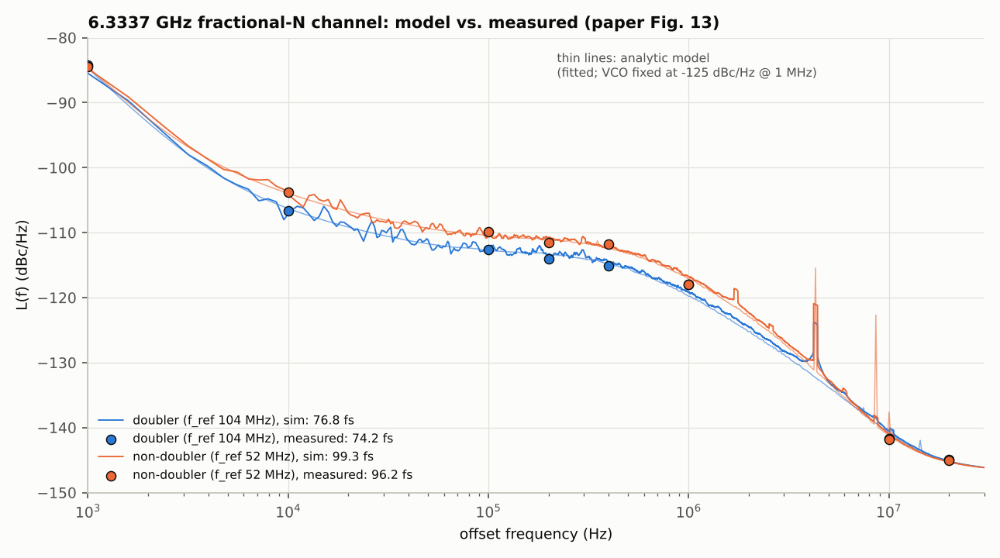
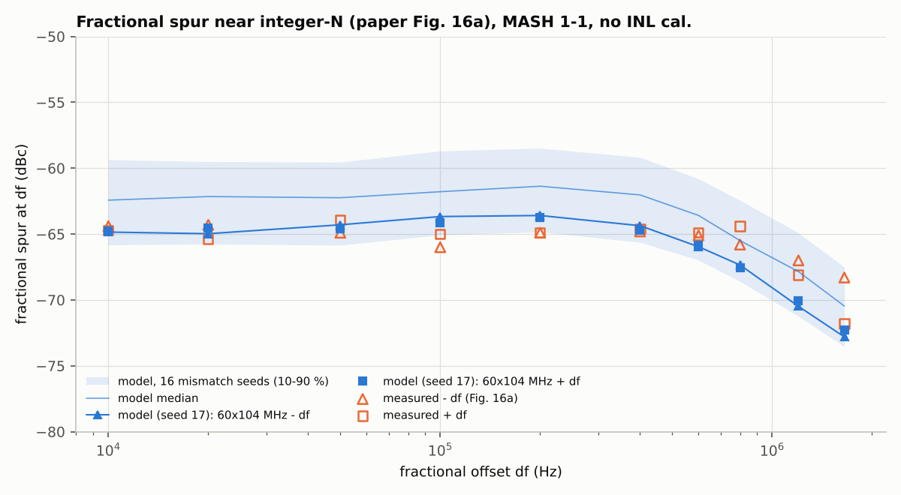
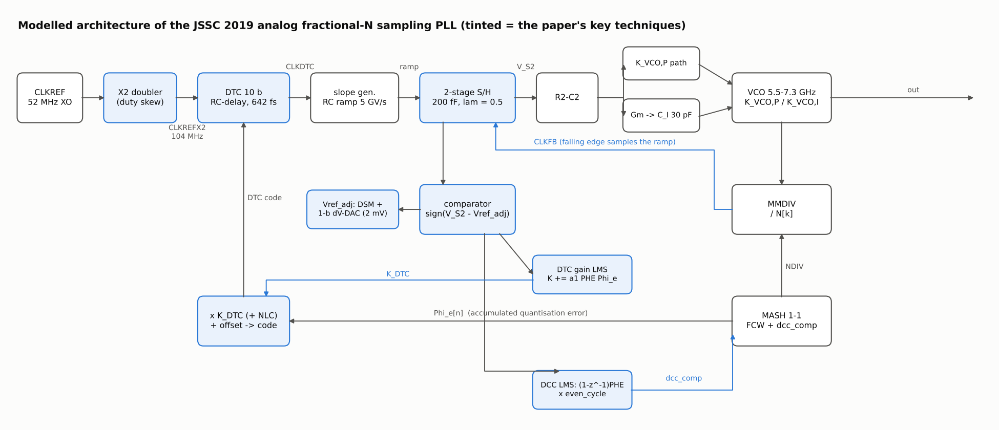
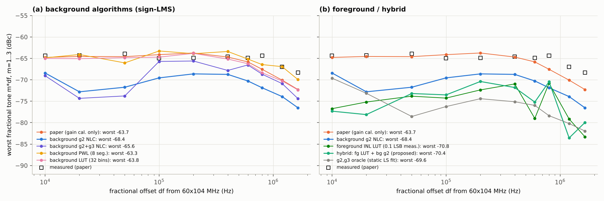
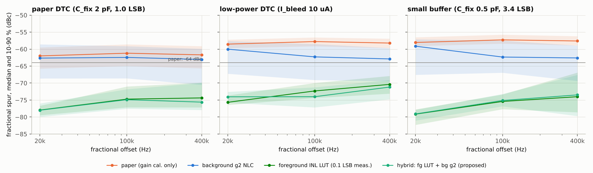

# Wu et al., JSSC 2019：28nm 75fs 模拟小数分频采样 PLL 的 Python 复刻，以及 DTC INL 校准扩展设计

> W. Wu, C.-W. Yao, K. Godbole, et al., "A 28-nm 75-fs<sub>rms</sub> Analog Fractional-N Sampling PLL With a
> Highly Linear DTC Incorporating Background DTC Gain Calibration and Reference Clock Duty Cycle
> Correction," *IEEE JSSC*, vol. 54, no. 5, pp. 1254–1265, May 2019.

本仓库包含两部分：

1. **原文复刻**：依据论文全文、作者 2024 年 IEEE CAS 教程和 2025 年 SSC-M 的 DTC 综述，搭建逐参考周期的时域行为模型，并建立与之完全一致的线性噪声模型。未知的噪声参数用论文 Fig. 13 的实测相噪拟合得到。
2. **扩展设计**：在论文架构上加入 DTC 非线性校准（NLC），评估多种算法并与原设计对比，最后给出推荐方案。

推荐方案（前台 INL 逆映射表 + 后台 g2 + 论文原有 K_DTC/DCC 环路）的完整设计报告见
[docs/design_report_hybrid_nlc.md](docs/design_report_hybrid_nlc.md)（PDF 版：
[docs/design_report_hybrid_nlc.pdf](docs/design_report_hybrid_nlc.pdf)）；接手本项目请先读
[docs/HANDOFF.md](docs/HANDOFF.md)。

> **版本说明**：v1 只依据摘要和专利写成，其中若干架构猜测有误，已移到 `legacy/v1_before_fulltext/` 备查。
> 本版（v2）的主要更正：DTC 位于**参考路径**；DTC 为 **RC-delay 变斜率结构**（INL 约 1 LSB）；环路为 **P/I 双路径、无电阻**；采样器为两级 S/H，带 IIR；DTC 增益校准用 **sign-data LMS**（PHE·Φe）；DCC 经 ΣΔM 对 CLKFB 交替推拉 ΔT/2；50 µs 后 gear-shift。

---

## 1. 复刻结果与论文对比

| 项目 | 论文（实测或文中数据） | 本模型 |
|---|---|---|
| 抖动，doubler 模式，6.3337 GHz，10 kHz–10 MHz | **74.2 fs**（Fig. 13；标称 75 fs） | **76.8 fs**（时域，含全部后台校准）/ 73.0 fs（解析） |
| 抖动，non-doubler 模式（f_ref = 52 MHz） | 96.2 fs | 99.3 fs / 97.0 fs |
| L(f)，doubler：10k / 100k / 400k / 1M / 10M / 20M Hz | −106.7 / −112.6 / −115.1 / −118.0 / −141.7 / −144.9 | −106.4 / −112.6 / −115.0 / −119.3 / −140.5 / −145.2 |
| FoM（18.9 mW） | −249.7 dB | −249.5 dB |
| 环路带宽 | 约 600 kHz | f_unity 620 kHz，PM 72° |
| DTC：LSB / INL / DNL | 642 fs / 约 1 LSB / ±0.2 LSB | 642 fs / 0.97 LSB / 0.15 LSB |
| K_DTC 校准（初值 200…1600，理想值 895） | < 50 µs | 15–21 µs（收敛到 ±1 %） |
| DCC 收敛 | < 20 µs | 17–23 µs（收敛到 ±2 ps） |
| 比较器阈值（50 mV 失配） | 收敛到 0.45 V | 0.450 V |
| Fig. 9b：1 % 占空比误差、无 DCC | 带内恶化 > 10 dB | 带内恶化 17 dB，586 fs，52 MHz 杂散 −58 dBc |
| Fig. 9b：6 % 占空比 + 50 % K_DTC 初值误差，两路校准打开 | 与理想情况相近 | 76.7 fs，理想情况 76.5 fs（DCC 收敛到 577 ps） |
| Fig. 16a：近整数分频的小数杂散 | 带内 −63.9 … −66 dBc | 代表性芯片（mismatch seed 17）−63.6 … −65 dBc；16 个 seed 的中位数 −61.4 dBc |
| Fig. 16b：全频段抖动 | 73–85 fs（−40 °C / 50 °C） | 73.5–78 fs |
| Fig. 2b 线性模型分解（6720 MHz，10k–200M） | 87.5 fs；REF+DTC 39 %、VCO 51 % | 77 fs；REF+DTC 65 %、VCO 21 % |




### 复刻过程中的几点发现

* **带内噪声来自逐沿电路噪声**：参考 buffer、DTC 和 MMDIV 的噪声都按边沿计。doubler 模式与 non-doubler 模式实测带内相差约 3 dB，模型用同一组参数同时拟合了两条曲线（RMS 误差 0.66 dB）。
* **DTC 量化噪声并不是白噪声**：MASH 1-1 驱动下，量化噪声的谱形与信道相关。论文 Fig. 2 的线性模型按白噪声处理，这一项被高估了；本模型改为按实际码流计算。
* **小数杂散主要由随机 DNL 决定**：单位电容失配造成的码跳变约贡献 −62 dBc，Fig. 11 的平滑弓形 INL 只贡献约 −68 dBc。不同失配样本之间的杂散相差约 7 dB，实测芯片落在分布中较好的四分位。
* **DCC 的互调杂散**：ΣΔM 输入端的 ±d 交替分量会与小数图样互调。例如 200 kHz 信道在 2 MHz 处出现 −70 dBc 的杂散（校准环路实时运行时的结果）。论文没有讨论这一点，属于本模型的预测。
* **后台校准自身的抖动代价约 2.5 fs**：所有校准冻结在理想值时为 74.3 fs，后台环路实时运行时为 76.8 fs。主要来源是 DCC 通过 ΣΔM 引入的共模相位抖动。

---

## 2. 建模的架构（与论文章节的对应）



| 模块 | 模型实现（`spll/core.py`、`spll/loop.py`） | 论文出处 |
|---|---|---|
| 参考与倍频 | 52 MHz XO 经 XOR 倍频得到 104 MHz；由 CLKREF 下降沿产生的那一半边沿偏移 ΔT/2（ΔT = 48.5 ps） | Fig. 7，Sec. IV、VI |
| ΣΔM | MASH 1-1，输入为 FCW + dcc_comp；Φe = c2 − acc1/2^B | Fig. 8c |
| DTC（参考路径） | code = offset + K_DTC·Φe；RC 延迟 + 反相器斜率相关延迟（√C 律）；C_fix 2 pF；单位电容失配；电源记忆效应 | Fig. 10、11，Sec. V-A |
| SPD | RC 斜坡 V = VDD(1 − e^{−x/τ})，锁定点斜率 5 GV/s；CLKFB 下降沿采样；两级 S/H，λ = 0.5（IIR，z^−0.5） | Fig. 12，式 (5)–(7) |
| 环路 | R2C2 后分两路：P 路径（K_VCO,P）和 Gm→C_I（30 pF）→K_VCO,I；状态空间矩阵指数精确离散 | Fig. 1、2，Sec. II |
| 比较器与 Vref | PHE = sign(V_S2 − Vref_adj)；Vref 由一阶数字 ΣΔ + 1-bit ΔV-DAC（2 mV）生成 | Fig. 4、5c |
| K_DTC LMS | K += α1·PHE·Φe（sign-data），50 µs 后 α1 → α1/4 | Fig. 4、8a |
| DCC | dcc_err += α2·(1 − z^−1)PHE·even_cycle；dcc_comp = ∓dcc_err 送入 ΣΔM | Fig. 8a、8b |

`spll/linear_model.py` 用同一组离散矩阵计算各噪声源的传递函数。校准冻结时，它与时域仿真的抖动误差小于 1 %（有回归测试覆盖）。

## 3. 参数来源

`spll/params.py` 中每个参数都标注了来源：**[P]** 取自论文，**[M]** 由实测拟合，**[A]** 为假设。

* **[P]**：52 MHz 参考 ×2，10 bit DTC，LSB 642 fs，C_LSB 2 fF，C_fix 2 pF，K_slope 5 GV/s，C_S1 = C_S2 = 200 fF，C_I 30 pF，K_VCO,P/K_VCO,I < 1/10，ΔV-DAC 步长 2 mV，占空比误差 48.5 ps，50 µs gear-shift，VCO −125 dBc/Hz @ 1 MHz，INL 约 1 LSB，DNL ±0.2 LSB，记忆效应 < 0.3 LSB。
* **[M]**（`experiments/calibrate_noise.py`）：用 Fig. 13 两条曲线共 16 个 marker 同时拟合。拟合结果为：逐沿白噪声 313 fs，其 1/f 角频率 101 kHz，XO 在 1 kHz 处 −126.6 dBc/Hz，K_VCO,P = 4.86 MHz/V，测试 buffer 底噪 −146.9 dBc/Hz。
* **[A]**：Gm = 1.9 µS，R2C2 极点 15 MHz，λ_V = 1/64，LMS 步长（据 Fig. 9a 的收敛时间选取），失配 0.5 %。

---

## 4. 扩展：增加 DTC INL 校准的设计评估

论文没有做 INL 校准，最差小数杂散为 −64 dBc（文中称已优于带 NLC 的同类设计）。这一部分评估在**不增加模拟电路、复用同一个比较器**的前提下加入 NLC 的效果。

### 4.1 候选算法

| 方案 | 说明 | 依据 |
|---|---|---|
| paper | 只做增益校准 | 原文 |
| **background g2** | code += g2·(Φe² − ⟨Φe²⟩)，sign-LMS 后台自适应 | Wu SSC-M 2025 式 (12)，H. Park ISSCC'21 |
| background g2+g3 | 再加三阶项 | 同上 |
| background PWL / LUT | 8 段分段线性 / 32 项按码索引的查表 | Levantino JSSC'14 思路 |
| foreground LUT | 上电时一次性测量 DTC 曲线（rms 误差 0.1 LSB），用其反函数做预失真 | SSC-M 2025 Fig. 11/12 的测量方法 |
| **hybrid（推荐）** | foreground LUT + 后台 g2 + 原有 K_DTC/DCC 环路 | 本设计 |

### 4.2 关键结论：近整数信道的可观测性限制

MASH 1-1 的相位误差为 Φe = c2 − x，其中 x = acc1/2^B 在近整数信道上变化很慢。此时 PD 在快时间尺度上只能看到 **DTC 在相距一个 VCO 周期的两点上的误差之差**：D(x) = E(1−x) − E(−x)。误差中以 1 为周期的分量会被环路跟踪掉，PD 看不到，却仍然在输出端产生带内杂散。由此得到三点推论：

1. 回归量必须改为 Φe·(φ(1−x) − φ(−x))，它对 x 的条件均值为零，可以直接由数字域的 x 算出。直接用 Φe² 作回归量，在接近环路带宽的偏移频率上会产生偏置（仿真中 400 kHz 处反而恶化 11 dB）。
2. **只有低阶多项式基可辨识**：多项式的周期分量只有常数。PWL 和 LUT 这类灵活的基存在不可观测（或近似不可观测）的周期模式。PWL 学到的映射虽然减小了 D(x)，却使慢分量增大约 14 倍，杂散从 −64 dBc 恶化到 −42 dBc；加泄漏正则后也只能做到"不变差"。
3. g3 的估计会被 DNL 和记忆效应带偏，所以**只用 g2 更稳健**。

### 4.3 结果

**代表性芯片（paper DTC，seed 17），偏移 10 kHz–1.65 MHz 内的最差小数杂散：**

| paper | bg g2 | bg g2+g3 | bg PWL | bg LUT | fg LUT | **hybrid** | g2/g3 oracle |
|---|---|---|---|---|---|---|---|
| −63.7 | −68.4 | −65.6 | −63.3 | −63.8 | −70.8 | **−70.4** | −69.6 |

**12 个失配 seed 的 Monte-Carlo，带内最差杂散的中位数（dBc），以及近整数信道 6240.1 MHz 的抖动（后台环路实时运行）：**

| DTC 场景 | paper | bg g2 | fg LUT | **hybrid** | 抖动 paper → bg g2 → hybrid |
|---|---|---|---|---|---|
| 论文 DTC（C_fix 2 pF，400 µA） | −61.2 | −61.9 | −73.2 | **−72.4** | 80.9 → 78.0 → 76.8 fs |
| 低功耗 DTC（I_bleed 10 µA） | −57.8 | −60.0 | −69.9 | **−71.2** | 88.3 → 77.8 → 77.2 fs |
| 小 buffer（C_fix 0.5 pF，INL 3.4 LSB） | −57.3 | −58.8 | −73.1 | **−73.3** | 89.6 → 77.3 → 76.6 fs |

在普通小数信道（6333.7 MHz）上，各方案的抖动都在 76.3–78.8 fs 之间，NLC 环路本身几乎不增加噪声。

**温漂鲁棒性**：foreground 测量之后 INL 弓形又变化 0 % / 25 % / 50 % 时，最差杂散如下。

* 小 buffer DTC：fg LUT 为 −75.1 / −69.2 / −64.5 dBc，hybrid 为 −75.7 / −71.6 / −67.1 dBc。
* 论文 DTC：hybrid 在三种情况下都保持在 −72 dBc 左右。




### 4.4 结论与推荐

* **纯后台多项式 NLC（g2）**：成本低（+2 个累加器，+3 个乘法器，复用比较器）。对代表性芯片改善 4.7 dB，对 INL 较大的低成本 DTC 可把近整数信道抖动从 88–90 fs 拉回 77–78 fs。但它消除不了随机 DNL，Monte-Carlo 中位数只改善 1–2 dB。
* **推荐 hybrid 方案**：上电时测量一次 DTC 曲线并做反函数预失真，可消除弓形和 DNL；后台 g2 跟踪温漂，K_DTC 与 DCC 环路沿用论文设计。结果是：论文 DTC 的杂散中位数从 −61 改善到 −72 dBc，最差值优于论文的 −64 dBc；**还可以改用更省电或面积更小的 DTC**（降低 bleed 电流或缩小反相器 buffer），性能不低于原设计。
* **代价**：需要一次性测量 DTC INL（片上 ΣΔ-TDC 或频谱法），外加一张映射表：按 1/8 LSB 输入分辨率约 8k×10 bit；按整数码索引可减到 1k 项，但本模型未验证这种做法。
* **局限**：电源记忆效应是动态误差，静态预失真无法消除，所以低功耗 DTC 的杂散停在约 −71 dBc。

### 4.5 设计报告阶段的补充验证

* **g2 的开启时刻**：若 g2 从上电起就自适应，K_DTC 远离终值时的残余线性误差会泄漏进 g2 的回归量，K_DTC / DCC 的最差收敛时间从 38 / 29 µs 拉长到 70 / 55 µs（5 个初值 × 4 个信道 × 2 个噪声种子）。把 g2 推迟到 50 µs gear-shift 之后开启（`nlc_start=50e-6`），收敛时间与只用前台表时相同，杂散与不推迟时相差不超过 0.3 dB（论文 DTC）。见 `experiments/check_hybrid_startup.py` 与 `results/hybrid_startup.txt`。上面 4.3 的结果是在 `nlc_start=0` 下得到的。
* **前台测量误差的形态**：同为 0.1 LSB rms，逐码独立误差下 hybrid 为 −70.9 dBc；若 INL 由相邻码 DNL 累加得到（频谱法），误差在码域上是随机游走，hybrid 只有 −61.4 dBc，比不校准还差。累加型误差要压到 0.025 LSB rms（每一步约 2 fs）才能回到 −72.6 dBc。用参数 `fg_meas_mode='cumdnl'` 复现，见 `experiments/check_fg_measurement.py` 与 `results/fg_measurement.json`。

---

## 5. 运行

```bash
pip install numpy scipy matplotlib numba
```

```bash
python experiments/calibrate_noise.py      # 用 Fig. 13 实测拟合噪声参数，约 2 s
```

```bash
python experiments/run_repro.py            # 复刻论文各图，约 1 min，输出 figures/fig0-7、results/repro_summary.json
```

```bash
python experiments/run_nlc.py              # INL 校准扩展研究，约 2 min，输出 figures/fig8-12、results/nlc_summary.json
```

```bash
python experiments/check_hybrid_startup.py # g2 开启时刻对 K_DTC / DCC 收敛的影响，约 2 min
```

```bash
python experiments/check_fg_measurement.py # 前台测量误差扫描（逐码独立 / 累加型），约 5 min
```

```bash
python tests/test_model.py                 # 8 项回归测试，约 20 s（首次运行含 numba 编译）
```

开发时使用的版本：Python 3.13，numpy 2.5，scipy 1.18，numba 0.68，matplotlib 3.11（见 `requirements.txt`）。

## 6. 文件结构

```
spll/params.py        参数（每项标注 [P] 论文 / [M] 实测拟合 / [A] 假设）
spll/measured.py      论文实测数据（Fig. 13 markers、Fig. 16a、Fig. 9a、Table I）
spll/dtc.py           RC-delay DTC 物理模型（√C 斜率效应、失配、记忆效应）及三种 DTC 场景
spll/loop.py          SPD、两级 S/H、P/I 环路的精确采样数据模型和传递函数
spll/core.py          numba 逐周期内核（MASH 1-1、DTC、SPD、比较器与 ΔV-DAC、LMS、DCC、NLC）
spll/simulate.py      噪声与激励生成；spur_run 先收敛、再冻结、再无噪测量
spll/linear_model.py  解析噪声模型（包括按信道计算的 DTC 量化噪声谱）
spll/analysis.py      预白化 Welch 谱估计、积分抖动、flat-top 杂散测量
experiments/          calibrate_noise.py、run_repro.py、run_nlc.py、style.py、
                      check_hybrid_startup.py、check_fg_measurement.py
tests/test_model.py   回归测试
docs/                 混合 NLC 方案设计报告（.md / .pdf）、插图、交接说明 HANDOFF.md
legacy/v1_before_fulltext/   第一版（仅依据摘要和专利，已过时）
```

## 7. 局限

* 未建模的内容：S/H 开关电荷注入导致的参考杂散（论文实测 −70 dBc）、PFD-CP FLL 捕获过程、温度效应。
* VCO 相噪按 f² 缩放，所以全频段抖动是平的。实测在 7.3 GHz 附近升到 85 fs，原因是频带边缘 VCO 性能变差，本模型未包含。
* DTC 的随机失配采用 Pelgrom 模型，默认 seed 选的是与实测杂散相当的代表性样本；论文图上读取的数据误差约 ±0.3 dB。
