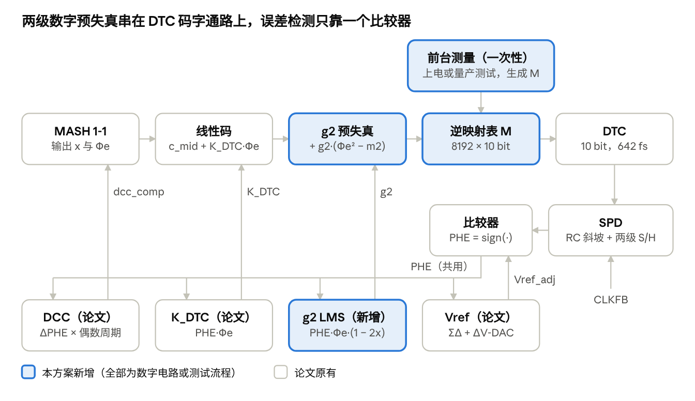
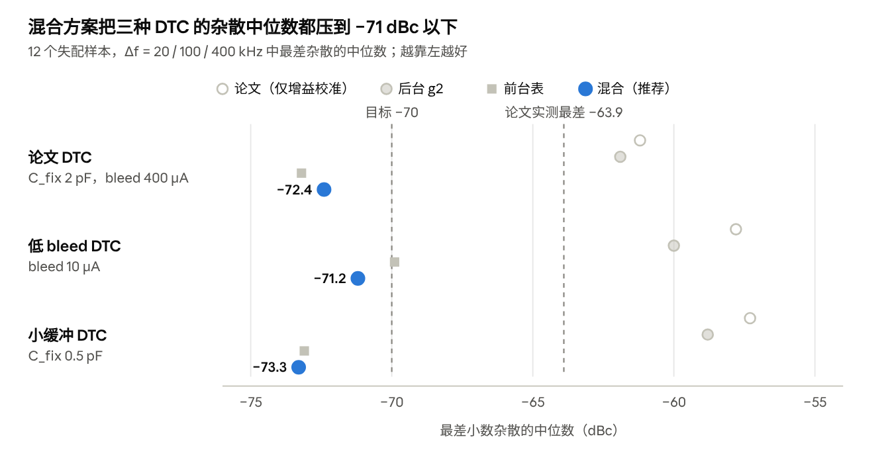
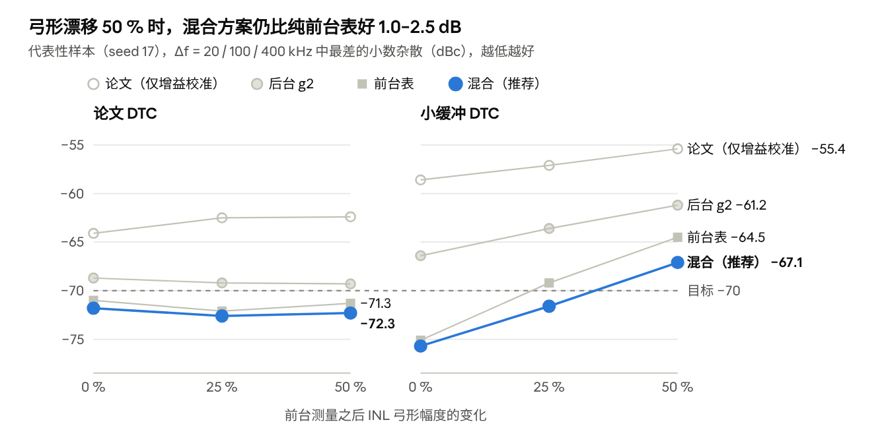
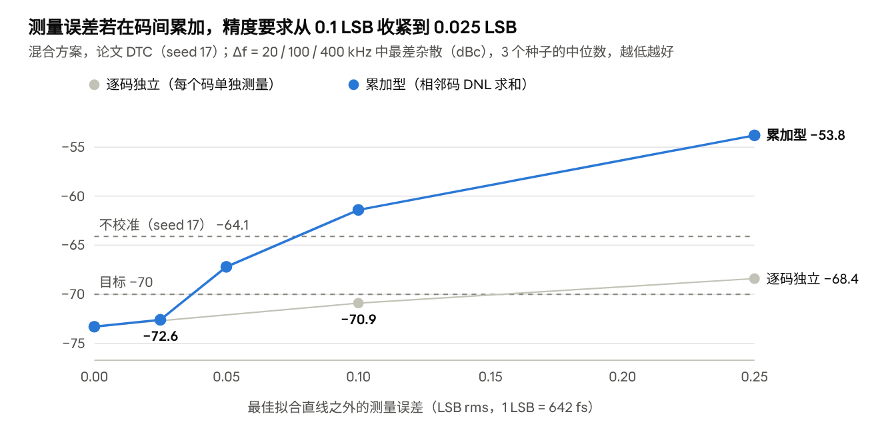

# 混合 DTC 非线性校准方案设计报告

2026-11-04 · coolplay077

> 本文由 Claude Docs 在线文档导出。带全部图表的排版版本见 [design_report_hybrid_nlc.pdf](design_report_hybrid_nlc.pdf)；交接说明见 [HANDOFF.md](HANDOFF.md)。

## 摘要

**推荐方案：在 Wu 2019 JSSC 采样 PLL 原有的 K\_DTC 增益校准与参考时钟占空比校正（DCC）环路之外，增加“上电前台 INL 逆映射表 + 后台二阶弓形（g2）跟踪”的混合 DTC 非线性校准（NLC）。** 它不新增任何模拟电路，复用论文已有的比较器符号 PHE 和 ΣΔ 累积量化误差 Φe，在 12 个失配样本上把近整数信道带内最差小数杂散的中位数从 −61.2 dBc 降到 −72.4 dBc。

以下结论来自行为级模型。该模型先与论文实测对齐：积分抖动 76.8 fs（实测 74.2 fs），近整数小数杂散 −63.7 dBc（实测 −63.9 dBc）。

- **杂散**：与实测芯片对应的失配样本（seed 17）从 −63.7 dBc 改善到 −70.4 dBc，优于论文报告的 −64 dBc 最差值。
- **可以换用更便宜的 DTC**：反相器缓冲负载从 2 pF 减到 0.5 pF（INL 3.4 LSB）后，杂散中位数从 −57.3 改善到 −73.3 dBc，近整数信道积分抖动从 89.6 fs 降到 76.6 fs，与论文 DTC 持平。
- **耐温漂**：前台测量之后 INL 弓形再变化 50 %，混合方案仍为 −72.3 dBc（论文 DTC）和 −67.1 dBc（小缓冲 DTC），比纯前台表分别好 1.0 dB 和 2.5 dB。无漂移时两者相差不超过 1 dB，后台 g2 的价值在于跟踪漂移。
- **噪声代价可忽略**：普通小数信道 6333.7 MHz 的抖动为 76.5 fs，不加 NLC 时为 76.9 fs。
- **硬件代价**：一张 8k × 10 b 逆映射表、2 个累加器（g2 与 m2 滑动平均）、3 个乘法器，外加一次性的 DTC 曲线测量（片上 ΣΔ-TDC 或频谱法）。
- **局限**：电源记忆效应是动态误差，静态表无法校正，低 bleed 电流 DTC 的杂散停在约 −71 dBc。所有数字都来自行为模型，仍需晶体管级仿真和流片验证。

## 背景与问题

论文把 DTC 放在参考路径上抵消 ΣΔ 量化误差，所以 DTC 的任何非线性都会直接变成近整数信道的带内小数杂散；而论文只校准了 DTC 的增益，没有校准 INL。

### 原设计回顾

- **链路**：52 MHz 晶振经 XOR 倍频得到 104 MHz 的 CLKREFX2，经 10 bit DTC（LSB 642 fs）触发 RC 斜坡（5 GV/s），由分频反馈时钟 CLKFB 采样；两级 S/H 之后分为比例路径（变容管 K\_VCO,P）和 Gm–C\_I 积分路径。分频比由 MASH 1-1 调制，环路单位增益频率约 620 kHz。
- **后台校准**：一个比较器给出相位误差符号 PHE，同时供三个环路使用：Vref 跟踪（ΣΔ + 1 bit ΔV-DAC）、K\_DTC 增益校准（sign-data LMS，PHE·Φe）、DCC（偶数周期差分 PHE）。50 µs 后步长降为 1/4。
- **DTC 结构**：RC 延迟变斜率型，三类误差——反相器斜率相关延迟引起的平滑弓形 INL（约 1 LSB）、单位电容失配引起的随机 DNL（±0.2 LSB）、电源记忆效应（400 µA bleed 电流下小于 0.3 LSB）。

### 问题

在近整数信道（n × 104 MHz + Δf）上，累加器状态 x 变化很慢，DTC 误差以 Δf 为周期重复。Δf 低于环路带宽时，这个周期误差完全不被滤除。复刻模型在 Δf = 10 kHz–1.65 MHz 范围内的结果是：

- 与实测芯片对应的样本最差 −63.7 dBc（论文 Fig. 16a 实测 −63.9 至 −66 dBc）。12 个失配样本的中位数为 −61.2 dBc，样本之间相差约 7 dB。
- 按误差来源分解：只有弓形时杂散为 −68 dBc，只有 DNL 时为 −62 dBc，只有记忆效应时为 −80 dBc。**主导项是随机 DNL，而不是弓形。**
- 论文靠过尺寸设计把 INL 压在 1 LSB：2 pF 的反相器缓冲负载和 400 µA bleed 电流，DTC 功耗 2.7 mW，占整机 18.9 mW 的 14 %。想省这部分功耗或面积，INL 就会变大。

下表是本报告使用的三种 DTC 场景（无 NLC，其余设置与论文相同）：

| DTC 场景 | 改动 | INL 峰值（最佳拟合线） | DNL 峰值 | 记忆效应 | 杂散中位数 | 近整数抖动（6240.1 MHz） |
| --- | --- | --- | --- | --- | --- | --- |
| 论文 DTC | C\_fix 2 pF，bleed 400 µA | 0.97 LSB | 0.15 LSB | 0.3 LSB | −61.2 dBc | 80.9 fs |
| 低 bleed | bleed 10 µA（论文 Sec. V-A：INL 最大 2.4 LSB） | 2.0 LSB | 0.15 LSB | 0.9 LSB | −57.8 dBc | 88.3 fs |
| 小缓冲 | C\_fix 0.5 pF | 3.4 LSB | 0.14 LSB | 0.3 LSB | −57.3 dBc | 89.6 fs |

因此需要一种校准，满足四点：消除包括 DNL 在内的静态非线性；跟踪 PVT 漂移；不增加模拟电路；不增加噪声，也不干扰已有的 K\_DTC 与 DCC 环路。

## 设计目标与约束

目标是在论文 DTC 上把近整数杂散压到 −70 dBc 以下（比实测最差值好 6 dB），并且让 INL 更大的低成本 DTC 也能达到同样水平；约束是只动数字部分。每项目标是否达成见「仿真验证结果」一节。

### 指标

| # | 指标 | 目标 | 依据 |
| --- | --- | --- | --- |
| G1 | 近整数小数杂散，论文 DTC，12 个失配样本，Δf = 20 / 100 / 400 kHz 中最差值的中位数 | ≤ −70 dBc | 论文实测最差约 −64 dBc |
| G2 | 同上，每个 Δf 的 90 % 分位点 | ≤ −68 dBc | 良率 |
| G3 | 低 bleed 与小缓冲 DTC 的杂散中位数 | ≤ −70 dBc | 换用低成本 DTC 的前提 |
| G4 | 普通小数信道 6333.7 MHz 积分抖动（10 kHz–10 MHz）的增量 | ≤ 1 fs | NLC 不应引入噪声 |
| G5 | 近整数信道 6240.1 MHz 积分抖动，三种 DTC | ≤ 80 fs | 接近小数信道水平 |
| G6 | 前台测量后 INL 弓形再变化 50 %，论文 DTC 的杂散 | ≤ −70 dBc | 温度与电压漂移 |
| G7 | K\_DTC 与 DCC 的最差收敛时间 | 不慢于原设计（约 42 µs / 30 µs） | 不干扰原环路 |
| G8 | g2 收敛时间 | ≤ 2 ms | 仅上电时一次 |

G7 的基准来自复刻模型：5 个初始 K\_DTC（论文 Fig. 9a 的 200–1600）× 4 个信道 × 2 个噪声种子，50 mV Gm 失调，取最差值。

### 约束

- **不新增模拟电路**：误差检测只用已有比较器的 PHE；新增逻辑全部是数字电路，运行在 104 MHz 的 CLKREFX2 时钟域，每个参考周期更新一次。
- **回归量只用数字域已知量**：MASH 第一级累加器状态 x = acc1/2^B 和累积量化误差 Φe。
- **分工清楚**：线性增益仍由 K\_DTC 环路负责，NLC 只修正非线性。逆映射表以测量曲线的最佳拟合直线为目标，不改变 DTC 的等效增益。
- **存储**：不超过约 10 kB 的片上 SRAM 或寄存器。
- **前台测量**：只做一次，放在上电序列里，或在量产测试时完成后存入非易失存储。

## 方案架构

**混合方案在 DTC 码字通路上串入两级数字预失真：先加后台二阶项 g2，再查前台逆映射表；误差检测仍然只靠原有比较器的 PHE。**



*混合 NLC 架构 · 码字通路 5 级，后台环路 4 个*

上排是每个参考周期的码字通路，蓝色为新增部分；下排四个后台环路共用比较器输出的 PHE，各自把结果送回码字通路或比较器阈值。前台测量只在上电或量产测试时运行一次，生成逆映射表 M。

### 每个参考周期的信号流

1. MASH 1-1 输出第一级累加器状态 x = acc1/2^B 和累积量化误差 Φe = c2 − x。DCC 补偿字按论文加在 ΣΔ 输入上。
2. 线性码：c\_lin = c\_mid + K\_DTC·Φe，c\_mid 是码范围中点。
3. 后台二阶修正：c\_2 = c\_lin + g2·(Φe² − m2)。m2 是 Φe² 的滑动平均（一阶 IIR，系数 1/1024），使修正项均值为零，不扰动锁定点。
4. 前台逆映射：i = round(8·c\_2)，code = M\[i\]。M 共 8192 项、每项 10 bit，输入分辨率 1/8 LSB；每一项存的是“实测延迟最接近最佳拟合直线上目标延迟”的那个整数码。
5. code 驱动 DTC，DTC 输出触发斜坡，CLKFB 采样，经两级 S/H 后由比较器给出 PHE = sign(V\_S2 − Vref\_adj)。
6. 同一个 PHE 驱动四个后台环路：Vref、K\_DTC、DCC（均为论文原有）和新增的 g2，其更新式为 g2 ← g2 + μ2·γ·PHE·Φe·(1 − 2x)，γ 是步长档位。

两级的分工：逆映射表处理上电时已知的全部静态形状（弓形和逐码 DNL），g2 只处理测量之后弓形的变化。g2 放在查表之前，是因为查表之后的码域已经被线性化，剩下的漂移在这个域里接近一个纯二次项。

### 模块分工

| 模块 | 来源 | 实现 | 作用 |
| --- | --- | --- | --- |
| MASH 1-1（含 DCC 输入） | 论文 | 数字，保留 | 产生 x 与 Φe |
| K\_DTC sign-data LMS | 论文 | 数字，保留 | 线性增益 |
| DCC 环路 | 论文 | 数字，保留 | 倍频器占空比误差 |
| Vref 环路（ΣΔ + 1 bit ΔV-DAC） | 论文 | 混合信号，保留 | 比较器阈值跟踪锁定点 |
| g2 sign-LMS | 新增 | 数字：2 个累加器（g2、m2）、3 个乘法器 | 跟踪弓形漂移 |
| 逆映射表 M | 新增 | 8k × 10 b SRAM | 静态弓形 + DNL |
| 前台测量 | 新增流程 | 量产测试用频谱法，或片上 TDC 内建自测 | 一次性得到 DTC 曲线 |

前台测量有两条路径，都来自 Wu 的 SSC-M 2025 教程。频谱法（Fig. 11）逐码以方波在 i 与 i+1 之间切换，用频谱仪读一阶边带换算出延迟步长，再把 DNL 累加成 INL；片上方法（Fig. 12）把 DTC 绕成一阶 TR-TDC，可作量产内建自测。两者误差形态不同，影响见「风险、局限与后续工作」。

### 上电校准时序

| 阶段 | 时间 | K\_DTC / DCC 步长 | g2 有效步长 μ2·γ | 动作 |
| --- | --- | --- | --- | --- |
| 0 | 上电前或量产测试 | — | — | 测量 DTC 曲线，求最佳拟合直线，生成 M |
| 1 | 0–50 µs | α1、α2 | 冻结 | 锁定；K\_DTC、DCC、Vref 大步长收敛 |
| 2 | 50–200 µs | α/4（论文 gear-shift） | 1/16 | g2 开始自适应 |
| 3 | 200 µs 之后 | α/4 | 1/256 | g2 第二次降档，进入低噪声跟踪；约 1.5 ms 收敛 |

**g2 冻结到 50 µs 是本方案增加的时序规则。** 如果 g2 从 0 µs 起就自适应，K\_DTC 远离终值时的残余线性误差会泄漏进 g2 的回归量，K\_DTC 与 DCC 的最差收敛时间从 38 / 29 µs 拉长到 70 / 55 µs。推迟到 50 µs 后，两者与只用前台表时完全相同，也不慢于论文原设计（42 / 30 µs）；论文 DTC 在 20 / 100 / 400 kHz 三个偏移处的杂散与不推迟时相差不超过 0.3 dB。

切换信道时，M 不变；K\_DTC 按论文重新收敛。g2 是 DTC 本身的属性，建议沿用上一信道的值——这一点本报告尚未仿真验证。

## 关键原理

**在近整数信道上，后台环路只能看到 DTC 误差在相距一个 VCO 周期的两点上的差值。因此后台只能辨识低阶多项式，逐码的形状（DNL）必须由前台测量提供。** 这是混合方案分工的依据。

### 1. 相位检测器能看到什么

MASH 1-1 的累积量化误差为 Φe = c2 − x，c2 ∈ {0, 1}。给定 x 时，Φe 只可能取 1 − x 或 −x，且 P(c2 = 1 | x) = x，所以 E\[Φe | x\] = 0。记线性增益校准之后的 DTC 延迟误差为 E(Φe)，它可以精确分解为两部分：

```math
E(\Phi_e) = \underbrace{x\,E(1-x) + (1-x)\,E(-x)}_{S(x)\ \text{慢分量}} \; + \; \Phi_e\, D(x), \qquad D(x) = E(1-x) - E(-x)
```

- **快分量 Φe·D(x)** 随 c2 逐周期翻转，和 Φe 相关，可以由 PHE·Φe 类的相关运算测到。
- **慢分量 S(x)** 只依赖 x。近整数信道上 x 以 Δf 缓慢扫过 \[0, 1)，S(x) 是一个频率为 Δf 的周期波形，在带内直接形成杂散。它与 Φe 的条件相关为零，又被环路跟踪，PHE 几乎看不到它。

后台环路的作用等价于把 D(x) 压到零，也就是让 E(1 − x) = E(−x)。对一般的误差曲线，这并不蕴含 S(x) 为常数：任何以 1 为周期的分量都满足 D(x) = 0，却仍然产生杂散。

### 2. 只有低阶多项式可以被后台辨识

若修正基是低阶多项式，唯一以 1 为周期的多项式是常数，所以 D(x) → 0 就推出 S(x) → 常数，杂散随之消失。PWL 和按码索引的 LUT 自由度多，其张成的空间里存在大量周期为 1 的模式：LMS 沿这些方向没有恢复力，会自由漂移。仿真中 8 段 PWL 把 D(x) 压小了，慢分量却增大约 14 倍，杂散从 −64 dBc 恶化到 −42 dBc；加泄漏正则之后也只是“不变差”（−63.3 dBc）。

### 3. 回归量必须去掉慢分量

直接用 Φe² 作回归量时，它自身也带着一个只依赖 x 的慢分量，会和带内被环路移相的误差相关，引入偏置：仿真中 400 kHz 偏移处的杂散反而恶化 11 dB。对基函数 φ 应使用条件均值为零的可观测回归量：

```math
r_\varphi = \varphi(\Phi_e) - \mathbb{E}\left[\varphi(\Phi_e) \mid x\right] = \Phi_e\,\bigl(\varphi(1-x) - \varphi(-x)\bigr)
```

取 φ = Φe² 得 r = Φe·(1 − 2x)，于是 g2 的更新式为：

```math
g_2[k+1] = g_2[k] + \mu_2\,\gamma[k]\;\mathrm{PHE}[k]\;\Phi_e[k]\,\bigl(1 - 2x[k]\bigr)
```

(1 − 2x) 只需要 MASH 第一级累加器的高位。此外，K\_DTC 的回归量是 Φe，而 x 在 \[0, 1) 上均匀时 E\[Φe · Φe(1 − 2x)\] = E\[x(1 − x)(1 − 2x)\] = 0，两个环路在一阶近似下正交，稳态时互不干扰。启动阶段 K\_DTC 误差很大时不满足这个近似，这正是 g2 要推迟到 50 µs 开启的原因。

### 4. 为什么只用 g2，不加 g3

- 三阶回归量 Φe·(0.6 − 3x + 3x²) 与模型外的 DNL 和记忆效应残差相关，g3 的估计被带偏。代表性样本上 g2+g3 为 −65.6 dBc，比只用 g2 的 −68.4 dBc 差 2.8 dB；用静态最小二乘拟合得到的理想 g2、g3 也只有 −69.6 dBc。
- 弓形来自反相器斜率相关延迟（√C 律），光滑且以二次为主。在 Φe 实际用到的码范围内，只用 g2 就把 INL 峰峰值从 0.46 LSB 降到 0.20 LSB（论文 DTC），小缓冲 DTC 从 0.97 LSB 降到 0.21 LSB，剩余部分主要是 DNL。

### 5. 为什么还要前台表

随机 DNL 是小数杂散的主导项（−62 dBc，弓形只有 −68 dBc），而 DNL 不是低阶形状，后台无法辨识。前台测量直接得到整条曲线，不经过 D(x) 这一投影，没有可观测性限制。它的残差只剩三项：测量误差、测量之后的漂移、记忆效应。其中漂移主要是弓形的变化，由 g2 补上。

## 详细设计参数

下表是可以直接交给 RTL 的参数。除标注“建议”的定点字长外，其余数值都与仿真所用一致。**最关键的一项是前台测量精度，而且要求取决于测量误差是否在码间累加。**

### 前台逆映射表

| 参数 | 值 | 说明 |
| --- | --- | --- |
| 表项数 | 8192（1024 码 × 8） | 输入分辨率 1/8 LSB |
| 每项位宽 | 10 bit | 输出即 DTC 码 |
| 存储 | 80 kbit（约 10 kB） |  |
| 生成方法 | 对测量曲线做最小二乘直线拟合；对每个 1/8 LSB 目标点，取测量延迟最接近目标的整数码 | 不改变 DTC 等效增益，K\_DTC 环路照常工作 |
| 测量精度：逐码独立误差 | ≤ 0.1 LSB rms（约 64 fs） | 例如片上 TDC 对每个码单独平均 |
| 测量精度：INL 由相邻码 DNL 累加得到 | 累加后 ≤ 0.025 LSB rms，即每一步 ≤ 0.003 LSB（约 2 fs） | 误差累加成随机游走，幅度要求严 4 倍 |

两种误差形态的差别很大：同样是 0.1 LSB rms，逐码独立误差下混合方案为 −70.9 dBc，累加型误差下只有 −61.4 dBc，比不校准还差。原因是随机游走在约一个 VCO 周期对应的码距（约 246 码）上有很大的起伏，正好落在产生慢分量 S(x) 的尺度上。数据见「仿真验证结果」。

### 后台 g2 环路

| 参数 | 值 | 说明 |
| --- | --- | --- |
| 修正项 | g2·(Φe² − m2)，加在查表之前 |  |
| 回归量 | Φe·(1 − 2x) | x 取 MASH 第一级累加器高位 |
| 误差信号 | PHE（1 bit） | 与 Vref、K\_DTC、DCC 共用同一个比较器 |
| 步长 μ2 | 0.25 码/次 |  |
| 步长档位 γ | 0（0–50 µs）→1/4（50–200 µs）→1/64（200 µs 之后） | 有效步长 μ2·γ = 0、1/16、1/256 |
| m2 | Φe² 的一阶 IIR 平均，系数 1/1024，初值 1/6 | x 均匀时 E\[Φe²\] = 1/6 |
| g2 初值 | 0，或上次保存的值 |  |
| g2 取值范围 | 纯后台校准时的终值：论文 DTC 0.38 码，小缓冲 DTC 0.99 码 | 混合方案中 g2 只跟踪漂移，数值更小 |
| 定点字长（建议） | g2：1 符号 + 3 整数 + 16 小数；Φe：14 bit；x：高 8 位 | 未做定点仿真 |

### 原有环路（保持不变）

| 参数 | 值 | 来源 |
| --- | --- | --- |
| K\_DTC 步长 α1 | 0.5 码/次 | 模型假设，论文未给出 |
| DCC 步长 α2 | 2 × 10⁻⁴ 个 VCO 周期/次 | 模型假设 |
| gear-shift | 50 µs 后 α → α/4 | 论文 |
| Vref 环路 | 1 bit ΔV-DAC，步长 2 mV；数字 ΣΔ 增益 1/64 | 步长来自论文，增益为模型假设 |

### 评估条件

- **近整数信道**：60 × 104 MHz + Δf。代表性样本扫 Δf = 10 kHz–1.65 MHz 的 10 个点；Monte-Carlo 取 20 / 100 / 400 kHz。
- **杂散定义**：Δf、2Δf、3Δf 处最大的带内小数杂散。校准先带噪声收敛（混合方案 300k 个参考周期，即 2.9 ms），再冻结校准状态、关闭噪声测杂散。
- **抖动**：10 kHz–10 MHz 积分，后台环路实时运行，信道 6240.1 MHz（近整数）与 6333.7 MHz（论文 Fig. 13 信道）。
- **DTC**：「背景与问题」中的三种场景，12 个单位电容失配样本。

## 仿真验证结果

**在“逐码独立、rms 0.1 LSB”的测量误差假设下，混合方案达成全部 8 项目标；但结论对测量误差的形态很敏感。** 下面先核对目标，再分项给出杂散、抖动、漂移和测量误差的结果。

### 目标核对

| # | 目标 | 结果 | 达成 |
| --- | --- | --- | --- |
| G1 | 论文 DTC 杂散中位数 ≤ −70 dBc | −72.4 dBc | 是 |
| G2 | 每个 Δf 的 90 % 分位点 ≤ −68 dBc | 20 / 100 / 400 kHz：−76.0 / −71.8 / −69.9 dBc | 是 |
| G3 | 低 bleed、小缓冲 DTC 中位数 ≤ −70 dBc | −71.2 / −73.3 dBc | 是 |
| G4 | 小数信道抖动增量 ≤ 1 fs | 三种 DTC 均为负增量（−0.3 至 −2.3 fs） | 是 |
| G5 | 近整数信道抖动 ≤ 80 fs | 76.6–77.2 fs | 是 |
| G6 | 弓形漂移 50 % 后论文 DTC ≤ −70 dBc | −72.3 dBc | 是；小缓冲 DTC 为 −67.1 dBc，不在目标内 |
| G7 | K\_DTC / DCC 最差收敛不慢于 42 / 30 µs | 38 / 29 µs（g2 于 50 µs 开启） | 是 |
| G8 | g2 收敛 ≤ 2 ms | 纯后台 g2：论文 DTC 1.4 ms，小缓冲 DTC 0.6 ms | 是 |

### 方案对比



*results/nlc\_summary.json · 3 种 DTC × 4 种方案，各 12 个失配样本*

无论哪种 DTC，只有含前台表的两种方案能把杂散压到 −70 dBc 目标以下；纯后台 g2 只比论文好 0.7–2.2 dB，因为它消除不了 DNL。

代表性样本（seed 17，对应实测芯片）在 Δf = 10 kHz–1.65 MHz 的 10 个点上的最差杂散如下。纯后台的 PWL 与 LUT 都没有改善，对应「关键原理」中的可观测性限制；前台表和混合方案甚至优于理想的 g2/g3 拟合，因为只有它们能消除 DNL。

| 论文（仅增益校准） | 后台 g2 | 后台 g2+g3 | 后台 PWL | 后台 LUT | 前台表 | **混合** | g2/g3 理想拟合 |
| --- | --- | --- | --- | --- | --- | --- | --- |
| −63.7 | −68.4 | −65.6 | −63.3 | −63.8 | −70.8 | **−70.4** | −69.6 |

### 抖动

积分抖动（10 kHz–10 MHz，fs），后台环路实时运行：

| DTC | 信道 | 论文 | 后台 g2 | 混合 |
| --- | --- | --- | --- | --- |
| 论文 DTC | 6240.1 MHz（近整数） | 80.9 | 78.0 | 76.8 |
| 低 bleed | 6240.1 MHz | 88.3 | 77.8 | 77.2 |
| 小缓冲 | 6240.1 MHz | 89.6 | 77.3 | 76.6 |
| 论文 DTC | 6333.7 MHz（小数） | 76.9 | 76.4 | 76.5 |
| 低 bleed | 6333.7 MHz | 78.2 | 76.4 | 76.8 |
| 小缓冲 | 6333.7 MHz | 78.8 | 76.3 | 76.5 |

近整数信道的抖动改善主要来自弓形：弓形把量化噪声折叠进带内，只用后台 g2 就能拿回大部分；前台表再消掉 DNL，另外改善约 1 fs。小数信道上各方案最多相差 2.5 fs，NLC 环路本身没有引入可见的噪声。

### 温漂鲁棒性

前台测量之后，把 INL 弓形的幅度再改变 0 / 25 / 50 %（模拟温度或电压变化），考察各方案的最差杂散。



*results/nlc\_summary.json · seed 17，弓形变化 0 / 25 / 50 %，2 种 DTC × 4 种方案*

小缓冲 DTC 的弓形是论文 DTC 的约 3.5 倍，同样的相对漂移意味着更大的绝对误差，所以退化更明显。g2 只能跟踪漂移中的二次分量，只补回了一部分；对这类大 INL 的 DTC，温度变化大时仍需要重做前台测量。

### 前台测量误差的影响

对代表性样本分别注入两种形态的测量误差，取 3 个测量与噪声种子下 20 / 100 / 400 kHz 最差值的中位数。逐码独立误差对应对每个码单独测量；累加型误差对应频谱法逐步测 DNL 再累加成 INL。两者都按最佳拟合直线之外的 rms 误差归一。



*results/fg\_measurement.json · 混合方案，论文 DTC，两种误差形态各 3 个种子*

同样的 rms 误差，两种形态的后果相差很大。累加型误差是码域上的随机游走，在约 246 码（一个 VCO 周期对应的码距）的尺度上起伏很大，正好落在产生慢分量 S(x) 的尺度上；逐码独立误差的能量分散在逐码的高频起伏上，产生的带内杂散小得多。小缓冲 DTC 的趋势相同：累加型误差 0.025 LSB 时为 −73.4 dBc，0.05 LSB 时已退到 −66.4 dBc。

## 硬件代价与方案对比

**混合方案的额外代价是一张约 10 kB 的表、一套 g2 运算和一次性的 INL 测量；换来的是杂散改善约 11 dB，以及把 DTC 做得更省电、更小的余地。**

### 各方案的代价与能力

| 方案 | 新增运算 | 存储 | 能校正 | 主要问题 |
| --- | --- | --- | --- | --- |
| 论文（仅增益校准） | — | — | 增益 | 弓形与 DNL 都不校正 |
| 后台 g2 | +2 累加器，+3 乘法器 | 2 个寄存器 | 增益、弓形及其漂移 | 消除不了 DNL |
| 后台 g2+g3 | +3 累加器，+6 乘法器 | 3 个寄存器 | 同上加三阶 | g3 被 DNL 与记忆效应带偏 |
| 后台 PWL（8 段） | +8 累加器，+2 乘法器 | 9 个节点 | 理论上任意平滑形状 | 周期模式不可观测，病态 |
| 后台 LUT（32 项） | 每周期 2 次累加 + 投影 | 32 项 | 理论上分段形状 | 同上 |
| 前台表 | 无 | 8k × 10 b | 弓形 + DNL（静态） | 跟不上漂移 |
| **混合** | +2 累加器，+3 乘法器 | 8k × 10 b + 2 个寄存器 | 弓形 + DNL + 弓形漂移 | 依赖测量精度；记忆效应仍在 |

g2 的 2 个累加器是 g2 本身和 m2 的滑动平均，3 个乘法器分别是 Φe²、g2·(Φe² − m2) 和 Φe·(1 − 2x)；PHE 是符号位，乘 PHE 只是取反。表每个参考周期读一次 10 bit，104 MHz 的访问速率对 28 nm SRAM 没有时序压力。存储的面积和功耗本报告没有估算，需要按工艺库核实。

### 为什么选混合，而不是单一方案

- **不只用后台 g2**：它最便宜，对代表性样本改善 4.7 dB，也能把大 INL DTC 的近整数抖动从约 89 fs 拉回 77 fs；但它消除不了主导杂散的 DNL，Monte-Carlo 中位数只改善 1–2 dB。
- **不只用前台表**：没有漂移时它与混合方案相差不到 1 dB，论文 DTC 上甚至略好；但测量后弓形一旦变化，它无法跟踪，小缓冲 DTC 在 50 % 漂移下比混合方案差 2.5 dB。g2 在表之上只多 2 个累加器和 3 个乘法器。
- **优雅降级**：如果前台测量失败或表内容失效，把 M 置为恒等映射即退化为纯后台 g2，仍保留近整数抖动的改善。

### 换来的设计余地

加上混合校准后，两种低成本 DTC 的杂散中位数都在 −71 dBc 以下，远好于论文 DTC 不校准时的 −61.2 dBc：

- **降低 bleed 电流**（400 µA → 10 µA）：DTC 电源电流减少 390 µA，按 0.8–1 V 供电估算约 0.3–0.4 mW，占 DTC 2.7 mW 的约 15 %。代价是记忆效应增大到 0.9 LSB，杂散受其限制停在 −71 dBc 左右。
- **缩小反相器缓冲**（C\_fix 2 pF → 0.5 pF）：缓冲尺寸约为原来的 1/4，其自身的开关功耗和面积相应减小。INL 虽然涨到 3.4 LSB，校准后杂散和抖动反而与论文 DTC 持平或更好。

这两项的功耗和面积收益只是量级估算，没有电路级数据支撑。

## 风险、局限与后续工作

**最大的风险是前台测量：如果 INL 由相邻码 DNL 累加得到，每一步的误差要小于约 2 fs，否则表会让杂散变差。** 其次是记忆效应，以及行为模型本身的假设。

### 风险

| 风险 | 影响 | 缓解 |
| --- | --- | --- |
| 测量误差在码间累加 | 累加后 0.1 LSB rms 时杂散约 −61 dBc，比不校准还差 | 优先采用逐码独立的测量；若只能用频谱法，把每步误差平均到 2 fs 以下；量产测试时加测近整数杂散，表不合格就重测或退回恒等映射 |
| 记忆效应 | 低 bleed DTC 杂散停在约 −71 dBc | 静态表无法校正，需要电路手段（bleed 电流、LDO）或带记忆项的预失真 |
| 弓形以外的漂移 | 如 DNL 随温度变化，表会失配 | 本报告只模拟了弓形幅度漂移，其他漂移需要另行评估 |
| g2 开启时刻 | g2 从 0 µs 起自适应时，K\_DTC / DCC 最差收敛变为 70 / 55 µs | 按时序表在 50 µs 后开启（已验证） |
| 小缓冲 DTC 的漂移 | 50 % 漂移时只有 −67.1 dBc | 大 INL 的 DTC 要求弓形更稳定，或在温度变化较大时重做前台测量 |

### 模型局限

- 所有结果来自行为级模型。DTC 的物理模型（√C 斜率律、二进制权重电容的失配、一阶记忆效应）是假设，只用论文 Fig. 11 和 Fig. 16a 做了校准。真实 DTC 的 DNL 结构不同（例如分段温度计码）时，各方案的排序可能变化。
- Monte-Carlo 只有 12 个失配样本、每个样本 3 个偏移频率；测量误差扫描只在一个失配样本上取了 3 个种子。个别点的波动可达 ±3 dB。
- 杂散是在校准冻结、关闭噪声后测得的。这样做会夸大 DCC 的交调音（与实时运行相比约 −60 对 −70.5 dBc），所以报告只统计 Δf、2Δf、3Δf 处的小数杂散。
- 未建模 S/H 开关电荷注入引起的参考杂散（论文实测 −70 dBc）、频率捕获过程和温度对噪声的影响。
- 数字部分使用浮点运算，没有做 bit-true 定点仿真。

### 后续工作

1. **确定前台测量方法**，并量化其误差形态。可以评估一种替代重建：先测二进制电容阵列各位的权重、再拟合平滑弓形，以避免 1023 步误差累加。
2. **bit-true 定点模型**：确定 g2、Φe、x 的字长；验证表的 1/8 LSB 分辨率能否降低（按整数码索引的 1k 项变体尚未验证）。
3. **扩展漂移模型**：加入 DNL 与电源变化，并验证切换信道时沿用 g2 是否可行。
4. **记忆效应**：评估以上一个码为第二维度的预失真，以突破低 bleed DTC 的 −71 dBc。
5. **码字窗口位置**：目前码范围中点正好落在 MSB 跳变处，MSB 的 DNL 会在 Φe = 0 处形成台阶，对应一个频率为 Δf 的锯齿波。可以评估把窗口移离 MSB 跳变点的效果。
6. **晶体管级与流片验证**。

## 附录：模型可信度与复现方法

所有结论都建立在一个先与论文实测对齐的行为模型上：主要指标与实测的差距在 4 % 以内，小数杂散落在实测范围之内。

### 复刻模型与论文实测

| 项目 | 论文 | 本模型 |
| --- | --- | --- |
| 积分抖动，doubler 模式，6.3337 GHz，10 kHz–10 MHz | 74.2 fs（Fig. 13） | 76.8 fs（时域，后台校准实时运行）；73.0 fs（解析） |
| 积分抖动，non-doubler 模式 | 96.2 fs | 99.3 fs；97.0 fs（解析） |
| FoM（18.9 mW） | −249.7 dB | −249.5 dB |
| 环路带宽 | 约 600 kHz | f\_unity 620 kHz，相位裕度 72° |
| DTC：LSB / INL / DNL | 642 fs / 约 1 LSB / ±0.2 LSB | 642 fs / 0.97 LSB / 0.15 LSB |
| K\_DTC 校准（初值 200–1600） | 50 µs 内 | 15–21 µs |
| DCC 收敛 | 20 µs 内 | 17–23 µs |
| 近整数小数杂散（Fig. 16a） | −63.9 至 −66 dBc | −63.6 至 −65 dBc（seed 17） |

模型参数分三类标注：\[P\] 论文给出，\[M\] 用 Fig. 13 实测相噪拟合（VCO 固定为 −125 dBc/Hz@1 MHz，拟合 RMS 误差 0.66 dB），\[A\] 假设。时域内核与解析噪声模型由同一组采样数据矩阵导出，两者的积分抖动相差 4 % 以内。

### 复现方法

代码、结果文件和本报告的导出版在 GitHub：[coolplay077-crypto/p1 · wu2019_spll](https://github.com/coolplay077-crypto/p1/tree/claude/wu2019-spll-hybrid-nlc/wu2019_spll)（分支 claude/wu2019-spll-hybrid-nlc）。接手时先读其中的 docs/HANDOFF.md。

代码是一个 Python 包（numpy、scipy、numba、matplotlib），以下命令在仓库根目录运行，时间为 4 核机器上的实测值。

```bash
pip install numpy scipy matplotlib numba
python tests/test_model.py                      # 8 项回归测试，约 20 s
python experiments/run_repro.py                 # 复刻论文各图，约 1 min
python experiments/run_nlc.py                   # NLC 方案对比、Monte-Carlo、抖动与漂移，约 2 min
python experiments/check_hybrid_startup.py      # g2 开启时刻对 K_DTC / DCC 收敛的影响，约 2 min
python experiments/check_fg_measurement.py      # 前台测量误差扫描，约 5 min
python experiments/check_fg_measurement.py cumdnl:0.025 cumdnl:0.05
```

| 结果文件 | 内容 | 本报告中的位置 |
| --- | --- | --- |
| results/repro\_summary.json | 复刻指标 | 本附录 |
| results/nlc\_summary.json | 方案对比、Monte-Carlo、抖动、漂移、g2 收敛 | 「仿真验证结果」 |
| results/hybrid\_startup.txt | K\_DTC / DCC 最差收敛时间与 g2 开启时刻 | 「方案架构」时序、G7 |
| results/fg\_measurement.json | 测量误差扫描 | 「详细设计参数」、「仿真验证结果」 |

关键代码位置：NLC 的码字通路和 g2 更新在 spll/core.py（nlc 模式 5 = 混合），逆映射表的生成在 spll/simulate.py 的 fg\_inverse\_map，全部参数在 spll/params.py。混合方案对应参数 nlc="fglut+poly"、mu\_g3=0；推荐时序再加 nlc\_start=50e-6。
