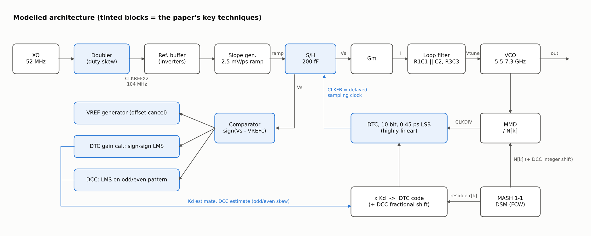
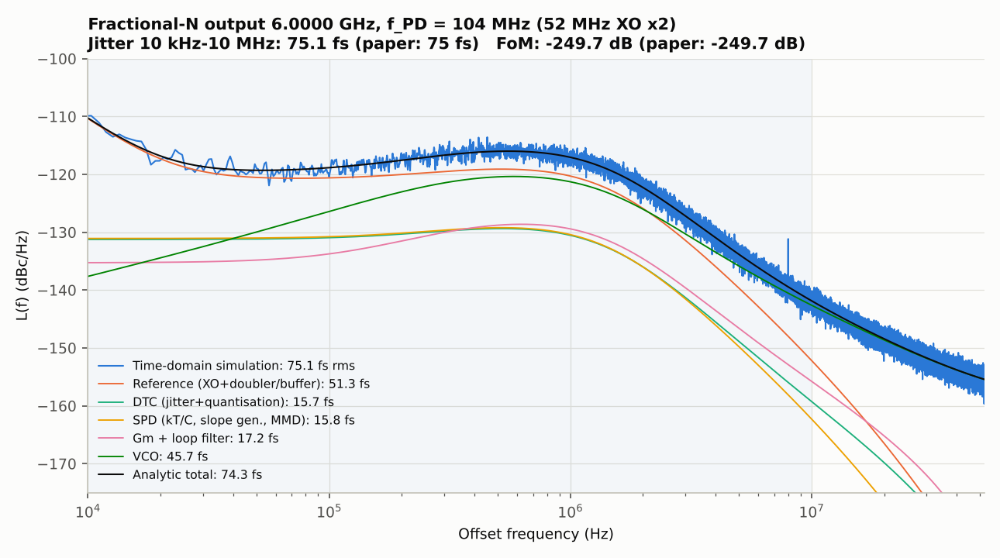
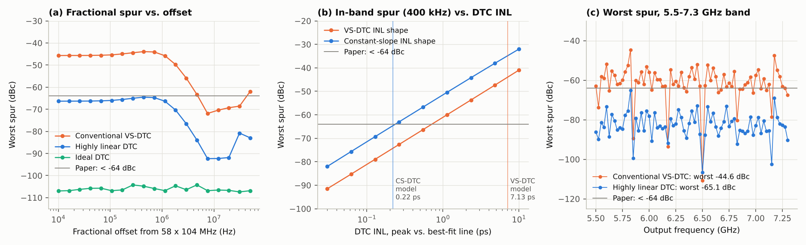

# Wu et al., JSSC 2019 —— 28nm 75fs 模拟小数分频采样PLL 的 Python 行为级复现

> W. Wu, C.-W. Yao, K. Godbole, et al., "A 28-nm 75-fs<sub>rms</sub> Analog Fractional-N Sampling PLL With a
> Highly Linear DTC Incorporating Background DTC Gain Calibration and Reference Clock Duty Cycle
> Correction," *IEEE JSSC*, vol. 54, no. 5, pp. 1254–1265, May 2019（会议版：RFIC 2018）。

本项目用 Python（numpy/scipy + numba）搭建了该论文方案的**逐参考周期时域行为模型**和与之一致的**线性化噪声解析模型**。论文的四项核心技术都在模型中实现并量化验证：

1. 基于 DTC 的模拟小数分频**采样 PLL**：S/H 采样 PD，DTC 输出作为延迟采样时钟；
2. **高线性度 DTC**；
3. 基于比较器符号的**后台 DTC 增益校准**（sign-sign LMS，带 VREF 失调消除）；
4. **参考时钟倍频器占空比校正（DCC）**。

---

## 1. 结果一览（论文 vs. 复现）

| 指标 | 论文 | 本复现 |
|---|---|---|
| 参考时钟 / PD 频率 | 52 MHz（片上倍频） | 52 MHz XO ×2 → 104 MHz |
| 输出频段 | 5.5–7.3 GHz | 5.5–7.3 GHz |
| 积分抖动（10 kHz–10 MHz，小数模式） | **75 fs** | **75.1 fs**（时域仿真），74.3 fs（解析模型），@6.0 GHz |
| 全频段抖动 | — | 73.3–75.9 fs（9 个信道） |
| FoM（按论文 18.9 mW 计算） | −249.7 dB | **−249.7 dB** |
| 最差小数杂散（全频段） | **< −64 dBc** | **−65.1 dBc**（高线性 DTC）；传统 DTC 为 −44.6 dBc |
| DTC | 10 bit | 10 bit，LSB 0.45 ps，量程 460 ps，INL 0.22 ps（0.49 LSB） |
| DCC 收敛（作者报告 < 30 µs） | — | 1 ns 占空比偏差：约 3 µs 粗收敛，约 30 µs 进入 ±2 ps |
| DTC 增益校准收敛 | — | ±15% 初始误差：9–11 µs 进入 ±0.5% |

其他关键数值（`results/summary.json` 中有完整记录）：

* 关闭 DTC（MASH 1-1 量化误差直接进入 SPD）：抖动 **917 fs**。SPD 输入误差 rms 68 ps，跨度约 ±167 ps，超出斜坡 287 ps（约 ±143 ps）的线性窗口。
* DTC 增益 +5% 误差且校准关闭：**90 fs**；打开后台校准：**75.1 fs**。
* 1 ns 占空比偏差且 DCC 关闭：PLL 实际无法正常锁定（2.1 ps）；20 ps 偏差时 52 MHz（f<sub>XO</sub>）杂散 **−79.8 dBc → −120.8 dBc**（DCC 开）。
* 由 INL 扫描得到的设计约束：带内杂散要低于 −64 dBc，DTC INL 需 ≲ **0.24 ps**（恒定斜率型 INL 形状）或 ≲ **0.7 ps**（弓形 INL）。

---

## 2. 建模的架构



```
XO 52MHz ─► 倍频器(占空比误差) ─CLKREFX2 104MHz─► 参考缓冲 ─► 斜坡发生器 ─┐
                                                                       ▼
            ┌──────────── CLKFB（DTC 延迟后的采样时钟）──────────────► S/H(200fF) ─Vs─► Gm ─► 环路滤波 ─► VCO ─► 输出
            │                                                          │
           DTC ◄─ CLKDIV ─ MMD ÷N[k] ◄──────────────────────────────────┼─────────────────────────────┘
            ▲                ▲                                         ▼
     Kd·(q−q_mid)       MASH 1-1 DSM                          比较器 sign(Vs−VREFc)
     (+DCC 小数部分)     (+DCC 整数部分)                        ├─► VREF 发生器（消除比较器失调）
            ▲                                                  ├─► DTC 增益 sign-sign LMS → Kd
            └──────────────────────────────────────────────────└─► DCC LMS（奇偶周期相关）→ 奇偶沿偏移
```

每个参考周期 k 的计算（`spll/core.py`）：

1. **DSM**：MASH 1-1 产生分频比 N[k] 及相位余量 r[k]（单位 T<sub>out</sub>）。
2. **DCC**：奇数 CLKFB 沿相对偶数沿延迟 d̂。整数周期部分通过 MMD 实现，小数部分 D<sub>f</sub> 以 ±D<sub>f</sub>/2 的差分形式通过 DTC 实现，因此 LMS 抖动不会带来带内共模相位噪声。
3. **DTC**：code = round(K<sub>d</sub>·(q − q<sub>mid</sub>) + 中间码)，采用中心化映射，并经一阶 ΣΔ 重量化 LSB；查表得到含 INL 的实际延迟，并叠加与码值相关的抖动。
4. **SPD**：参考沿启动斜坡（含有限 r<sub>o</sub> 压缩和限幅），CLKFB 沿采样，叠加 kT/C 噪声；Δt = 偏移 − τ<sub>VCO</sub> + (τ<sub>DTC</sub> − q·T<sub>out</sub>) − e<sub>ref</sub>。
5. **比较器 + 三个后台环路**：VREF 积分器、DTC 增益 LMS（K<sub>d</sub> −= μ·c·sgn(r − r<sub>mid</sub>)）、DCC LMS（d̂ −= μ·c·(−1)<sup>k+1</sup>）。步长采用“换挡”式逐级减小，以兼顾快速收敛与稳态精度。
6. **Gm → 环路滤波 → VCO**：S/H 输出在整个周期保持，因此用矩阵指数做精确的 ZOH 离散化，不存在仿真步长误差；可选子步长过采样输出，用于观察 52 MHz 杂散。

`spll/linear_model.py` 用**同一组离散化矩阵**计算各噪声源到输出的传递函数，与时域仿真互相校验：校准冻结时两者的抖动误差小于 1%（见 `tests/`）。

---

## 3. 哪些来自论文，哪些是假设（重要）

论文全文在 IEEE 付费墙后，本环境无法访问。以下信息来自摘要、RFIC 2018 摘要、三星专利摘要和作者后来的教程摘要：

| 来源 | 内容 |
|---|---|
| JSSC/RFIC 摘要 | 28 nm；DTC 型模拟小数分频采样 PLL；10 bit DTC 生成“延迟的采样时钟”；高线性 DTC；后台 DTC 增益校准；参考时钟（倍频）占空比校正；52 MHz 参考；5.5–7.3 GHz；75 fs（10 kHz–10 MHz）；FoM −249.7 dB；小数杂散 < −64 dBc；18.9 mW；0.45 mm² |
| 专利 US10581418 / US10725432（Wu、Yao，三星） | 比较器比较 Gm 输入电压与 VREF，VREF 由比较器输出自适应调节（消除失调）；DCC 从比较器输出提取奇偶误差并调整 CLKFB 相位；“快速收敛”的 DTC 增益/DCC 校准 |
| 作者教程（IEEE CAS，2024） | PD 为简单 S/H，采样电容约 200 fF；参考反相器缓冲可能主导相噪；DCC 在 30 µs 内收敛（1 ns 偏差）；RC/变斜率 DTC 的 INL 以二阶为主 |

**本复现的假设**（全部集中在 `spll/params.py`，可随意修改）：

* DSM 用 MASH 1-1，DTC 量程为 (2 + 0.5)·T<sub>out</sub>（对应 LSB 0.45 ps）。用一阶 DSM 时，背景校准在近整数信道会失效，原因见第 5 节。
* “高线性 DTC”用**恒定斜率（constant-slope）物理模型**实现：级联电流源有限 r<sub>o</sub>，加 1% 失配的电阻串 DAC。对比的“传统 DTC”为反相器型变斜率 DTC，检测级延迟 ∝ √C。论文的具体 DTC 电路未公开。
* 噪声参数：XO 噪底 −164.5 dBc/Hz@52 MHz，倍频器与缓冲抖动 155 fs/沿，DTC 抖动 60 fs（固定）+ 80 fs（满量程），VCO 在 1 MHz 偏移处 −123 dBc/Hz（6 GHz），斜坡 2.5 mV/ps，Gm = 200 µS，K<sub>VCO</sub> = 50 MHz/V，环路单位增益约 1 MHz（相位裕度 54°，−3 dB 带宽 1.7 MHz）。这些参数按物理合理性选取，并使总抖动落在论文的 75 fs 附近。
* 比较器失调 3 mV、噪声 0.3 mV；LMS 换挡步长表见 `params.py`。

所以，**75 fs 是用合理参数“对齐”出来的结果，而不是独立预测**。杂散结论（−65 dBc vs. −64 dBc）则来自 DTC 物理模型给出的 INL，没有专门调参。

---

## 4. 图表

| 图 | 内容 |
|---|---|
| `fig0_architecture.png` | 建模架构 |
| `fig1_dtc_inl.png` | 传统变斜率 DTC 与高线性（恒定斜率）DTC：传输曲线与 INL（7.1 ps vs. 0.22 ps） |
| `fig2_spd_dtc.png` | SPD 传输特性（287 ps 线性窗口）；有/无 DTC 时 SPD 输入误差分布（68 ps vs. 0.33 ps rms） |
| `fig3_dtc_gain_cal.png` | DTC 增益 LMS 收敛（±15%）；无 DTC / 增益误差 / 后台校准三种情况的相噪 |
| `fig4_dcc.png` | DCC 从 1 ns 偏差收敛；比较器 VREF 自适应；52 MHz 杂散 DCC 关/开 |
| `fig5_phase_noise.png` | 6 GHz 相噪：时域仿真 + 各噪声源解析分解；75.1 fs，FoM −249.7 dB |
| `fig6_frac_spur.png` | 小数杂散与偏移频率的关系、杂散与 DTC INL 的关系（设计曲线）、全频段最差杂散 |
| `fig7_jitter_band.png` | 5.5–7.3 GHz 全频段积分抖动 |




---

## 5. 复现过程中得到的几点设计认识

* **为什么必须用 DTC**：MASH 1-1 的量化误差跨 2·T<sub>out</sub>（约 333 ps），超出 S/H 斜坡约 287 ps 的线性窗口。不做抵消时 SPD 饱和且非线性折叠，抖动恶化到约 0.9 ps。
* **LMS 回归量与 DSM 阶数**：一阶 DSM 在近整数信道的余量是带内慢斜坡。二型环路会跟踪它，于是 sgn(e)·sgn(q) 的相关性变号，Kd 发散（实测 Kd 飘到 1.86 倍）。MASH 1-1 的余量本身是高通的（r = Δe<sub>2</sub>），所以在所有信道上都能稳定收敛。`gain_ref='dq'`（差分回归量）可作为一阶 DSM 的折中方案，但收敛很慢。
* **DCC 必须差分施加，DTC 码必须中心化**：早期版本只移动奇数沿，且 DTC 码未中心化。LMS 的随机游走以共模形式（d̂/2 和 K<sub>d</sub>·q̄）进入带内，使时域抖动比解析模型高约 19%（旧参数下 115 fs vs. 96.5 fs）。两处都改为差分/中心化后，误差小于 1%。
* **INL 与杂散呈 20 dB/dec 关系**，INL 的形状也有影响：在相同峰值 INL 下，带随机失配起伏的恒定斜率型 INL 比平滑弓形 INL 的杂散高约 9–10 dB，所以只看峰值 INL 不足以预测杂散。
* **α = 0.5 信道**（6.5 GHz）杂散极低：此时 MASH 1-1 余量序列的周期只有 2–4 个参考周期，INL 引起的误差全部落在 26/52 MHz，远在环路带宽之外而被滤除。已核实这与 DCC 无关：强制 DCC = 0 时，52 MHz 处仍低于 −125 dBc。

## 6. 局限性

未建模的内容：S/H 开关电荷注入和参考杂散（Gm 在整周期保持，无纹波）、VCO 的 K<sub>VCO</sub> 非线性、电源噪声、MMD 门级时序、片上 ÷2 等。输出频率直接按 VCO 频率处理，抖动以时间为单位，因此与分频无关。DTC 拓扑与噪声参数为假设，如能提供论文 PDF，可以按原文参数进一步校准。

---

## 7. 运行

```bash
pip install numpy scipy matplotlib numba
```

```bash
python experiments/run_all.py              # 全部实验，约 40 s，输出 figures/ 与 results/summary.json
```

```bash
python experiments/run_all.py pn spur      # 只跑部分实验：arch dtc spd gain dcc pn spur band
```

```bash
python tests/test_model.py                 # 7 项回归测试（约 5 s）
```

最小用法：

```python
from spll import SPLLParams, simulate, noise_budget, analysis as an
p = SPLLParams(f_out=6.0e9)                       # 修改任意参数，例如 dtc_type='inverter_vs'
r = simulate(p, (1 << 21) + (1 << 15), n_discard=1 << 15)
f, s = an.timing_psd(r.tau_steady(), r.fs_out)
print(an.integrated_jitter(f, s) * 1e15, "fs")    # ≈ 75 fs
```

## 8. 文件结构

```
spll/params.py        全部参数（论文给定值与假设值分组注释）
spll/dtc.py           DTC 模型：constant_slope / inverter_vs / ideal，INL/DNL/抖动
spll/loopfilter.py    SPD 增益、环路滤波器设计、精确 ZOH 状态空间离散化
spll/core.py          numba 逐周期内核（DSM、DCC、DTC、SPD、比较器与三个 LMS、环路）
spll/simulate.py      激励与噪声生成（FFT 整形的 XO/VCO 相噪），调用内核
spll/linear_model.py  同一离散模型的噪声传递函数与噪声预算
spll/analysis.py      Welch 相噪、积分抖动、flat-top 杂散测量、FoM
experiments/          run_all.py（全部实验与作图）、style.py
tests/test_model.py   回归测试
figures/  results/    输出
```
